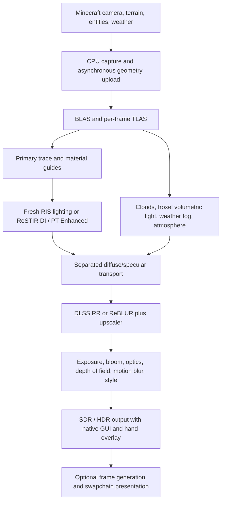

# Caustica Enhanced — Technical Report

**Target:** Minecraft 26.2 · Fabric · Vulkan · **Date:** 18 October 2026
**Language:** English ([简体中文](TECHNICAL_REPORT.zh-CN.md))

This report describes only what this source tree **implements**: algorithms, data flow, interfaces, resource ownership and defaults. It contains no roadmap, wish list or change history. A feature name identifies a selectable implementation; it does not assert output or performance parity with any other renderer. Numbers come from the source, the default configuration or build records, and the originating file is named.

> **Verification status (read this first):** this source tree passed a full build and the Java unit tests (66 suites / 231 tests, 2 skipped); shaders were compiled offline and validated with `spirv-val`. **This exact build has not been run on a GPU or in the game.** This document contains no frame-rate or image-quality measurements. See section 26.

---

## Contents

1. Purpose and size
2. Platform and dependencies
3. Device requirements and compatibility policy
4. Frame architecture
5. Geometry, acceleration structures and coordinates
6. Material system
7. PBR parallax
8. Sampling and emitter sampling
9. ReSTIR: Off / DI / PT Enhanced
10. Diffuse/specular signals and reconstruction
11. Indirect caches: Radiance Cache and SHARC
12. Dual-hand dynamic lights
13. Sky, celestial bodies and starfield
14. Clouds, volumetric light, fog and weather
15. Water
16. Dielectrics, glass and dispersion
17. Vegetation, particles and entities
18. Distant terrain: Voxy and Distant Horizons
19. Exposure, camera optics and post-processing
20. Colour pipeline, visual styles and HDR
21. Upscaling, denoising, frame generation and Reflex
22. Shader compilation, pipeline cache and loading overlay
23. Efficiency and diagnostics
24. Interface, configuration and instance directory
25. Professional offline photography
26. Build, tests and verification scope
27. Source map
28. Lineage and licences

---

## 1. Purpose and size

Caustica Enhanced is a **client-side** hardware path tracer integrated with Minecraft's Vulkan graphics backend. It captures Minecraft terrain and dynamic render submissions, builds acceleration structures, estimates light transport, reconstructs the noisy signals and presents SDR or HDR images while keeping the native game interface.

| System | Responsibility |
| --- | --- |
| World transport | Primary visibility, diffuse/glossy reflection, transmission, emissive surfaces, environment and local lighting |
| Resampling | Always-active fresh RIS lighting; selectable ReSTIR DI or ReSTIR PT Enhanced |
| Reconstruction | DLSS Ray Reconstruction; or NRD ReBLUR with DLSS/FSR/XeSS upscaling |
| Materials | Atlas and entity textures, LabPBR, height-field parallax, resource-pack material overrides, dielectrics and dispersion |
| Distant terrain | Voxy or Distant Horizons data converted to traceable Vulkan geometry |
| Atmosphere | Hillaire sky LUTs, celestial discs, starfield, Radiance clouds, froxel volumetric light, weather fog, End environment, aurora, rainbow |
| Camera / display | Exposure, bloom, optical-source tracking, depth of field, motion blur, visual styles, ACES 2.0 SDR/HDR |
| Presentation | Native GUI composition, Reflex, optional 2×–4× frame generation (DLSS / FSR / XeSS) |
| Offline photography | Tiled accumulation, up to 7680 px per side, multiple formats and metadata |

**Source size (measured in the maintainer workspace, including comments and blank lines)**

| Part | Files | Lines |
| --- | ---: | ---: |
| Main Java (`src/main/java`) | 213 | 38,651 |
| Test Java (`src/test/java`) | 66 | 3,508 |
| Slang shaders (`shaders/`) | 139 | 16,680 |
| Native code and GPU numerical tests (`native/`) | 72 files | — |

The default package uses one sample per pixel and three bounces (`caustica-defaults.toml`). Low sample counts depend on valid reconstruction and history; a low-noise screenshot alone is not evidence of correct transport.

---

## 2. Platform and dependencies

| Item | Version / constraint | Source |
| --- | --- | --- |
| Minecraft | 26.2 | `fabric.mod.json` |
| Fabric Loader | ≥ 0.19.5 (built with 0.19.5) | `fabric.mod.json`, `gradle.properties` |
| Fabric API | 0.153.0+26.2 | `gradle.properties` |
| Fabric Loom | 1.17.21 | `gradle.properties` |
| Java | ≥ 25 (bytecode target 25; built with JDK 26.0.2) | `fabric.mod.json`, `scripts/build.ps1` |
| NVIDIA NGX / DLSS | runtime 310.9.16.0, SDK headers 310.9.1 | `caustica-ngx-runtime.json` |
| NVIDIA NRD | 4.17.3 (ReBLUR) | `native/reconstruction/README.md` |
| NVIDIA NRI | pinned commit, used only for NRD's Vulkan integration | same |
| Intel XeSS | SDK 3.0.2 | same |
| AMD FidelityFX | SDK 1.1.4 (`ffx-api` Vulkan backend, FSR 3.1.4) | same |
| NVIDIA SHARC | 1.8.3.0 shader implementation (`shaders/extern/sharc`) | `THIRD_PARTY_NOTICES.md` |
| Distant Horizons | ≥ 3.3.3 (older versions rejected through `breaks`) | `fabric.mod.json` |
| Voxy | exactly 0.2.19-beta (other versions rejected through `breaks`); Sodium installed separately | `fabric.mod.json` |
| Sodium API | 0.9.2+mc26.2 (compile-time only, settings page) | `build.gradle` |
| NightConfig | 3.8.3 (TOML) | `build.gradle` |

The delivered native reconstruction bridge and NGX shim are Windows x64; a Linux build path exists for the NGX shim. Windows validation does not establish Linux reconstruction-runtime compatibility. DLSS and DLSS frame generation need supported NVIDIA hardware; 3×/4× multi-frame generation needs RTX 50 / Blackwell-class hardware. The project caps generated frames at 3 (4×) and does not implement dynamic multi-frame generation.

---

## 3. Device requirements and compatibility policy

**Required Vulkan features** (any missing one disables ray tracing; `RtDeviceBringup.REQUIRED_RT_FEATURES`): `bufferDeviceAddress`, `runtimeDescriptorArray`, `shaderSampledImageArrayNonUniformIndexing`, `descriptorBindingPartiallyBound`, `descriptorBindingSampledImageUpdateAfterBind`, `shaderInt64`, `accelerationStructure`, `rayTracingPipeline`, `rayTracingPositionFetch`, `rayQuery`.

**Optional capabilities** (enabled only when present):

| Capability | Use |
| --- | --- |
| `VK_EXT_ray_tracing_invocation_reorder` (SER) | selects `indirect_ser.rgen` instead of `indirect.rgen` |
| `VK_EXT_opacity_micromap` (OMM) | opacity micromaps for cutout geometry, behind a config switch |
| `VK_NV_low_latency2` + `VK_KHR_present_id` | Reflex and present-marker correlation |
| `wideLines` | block-outline line width |

**GPU tier policy**

- **GeForce RTX 20/30 (`RtGpuCompatibility`, matched by device name):** ordinary `TraceRay` and alpha-test any-hit; SER, OMM and DLSS frame generation are off; DLSS Ray Reconstruction stays available. DLSS frame generation on these GPUs is permitted only if the user has installed a third-party "SM86 unlock package" beside the Java executable (`RtDlssgUnlock` only detects its presence; it never bundles, downloads or modifies it).
- **Non-NVIDIA (`RtReconstructionPolicy`):** only FSR is offered for upscaling; the denoiser is fixed to NRD ReBLUR.
- **Default frame-generation provider (`RtFrameGenerationPolicy`):** device name matching RTX 40/50 → DLSS; everything else → XeSS. Generated frames = `clamp(requested, 1, clamp(supported, 1, 3))`.

---

## 4. Frame architecture

`RtComposite` (about 2,680 lines) coordinates the frame. `RtContext` owns device-level allocations, queues, the compiler cache and submission helpers. Terrain/entity modules own geometry and its generations; DI, PT, cache and volume resources have dedicated objects; native wrappers own reconstruction features until an idle-safe destruction boundary.

The **world pipeline** (`RtComposite.startWorldPipelineCompile`) consists of **16 ray-generation stages**, two miss shaders (`sky`, `guide`), `closest_hit` and `any_hit`:

| # | Stage | Role |
| ---: | --- | --- |
| 0 | `primary.rgen` | primary rays, material guides, path-segment queue |
| 1 | `indirect.rgen` (or `indirect_ser`) | indirect transport |
| 2 | `restir_temporal.rgen` | ReSTIR DI temporal reuse |
| 3 | `indirect_rr` | indirect transport for the DLSS RR contract |
| 4–5 | `volume_direct` / `volume_indirect` | froxel direct/indirect volumetric light |
| 6–7 | `indirect_cache` / `indirect_cache_rr` | transport with an indirect cache |
| 8 | `starfield_composite` | starfield composition |
| 9–13 | `restir_pt_initial / temporal / shifts / spatial / resolve` | the five ReSTIR PT stages |
| 14 | `offline_accumulate` | offline photography accumulation |
| 15 | `restir_pt_duplicates` | duplicate-seed map for the next temporal pass |

Stages 9–13 and 15 are compiled only while ReSTIR PT is selected; otherwise a tiny placeholder shader keeps stage indices stable. The first switch to PT rebuilds the pipeline once and shows the progress panel (section 22).

Shader structures and descriptor declarations are turned into matching Java records at build time by `buildSrc` Groovy tasks that read Slang reflection (`generateShaderRecords`, `generateRtBindings`), so hand-written layouts cannot drift. World parameters are read through a device address (`worldPush = ConstPtr<WorldPush>(pc.worldPushAddr)[0]`); the Vulkan push-constant block carries only hot fields and addresses, so no unusually large push-constant limit is required. Per-frame buffer rings keep submitted data immutable until it is safe to recycle.

---

## 5. Geometry, acceleration structures and coordinates

- **Near terrain** uses captured block-model geometry (`RtSectionBuilder`, `RtTerrainMesher`, `RtFluidMesher`). Section meshes can be built and uploaded asynchronously; defaults dispatch 64 and accept 64 results per tick with a 1.5 ms streaming budget (6 ms maximum, 8 ms fallback) and at most 192 sections in flight.
- **BLAS compaction** is on by default (`terrain.blas-compaction = true`).
- **Entities and block entities:** up to 1024 entities by default; block entities within 8 chunks, at most 8 builds per frame; entity texture pages capped at 256. Dynamic entity geometry is **refitted** while topology stays compatible and rebuilt every 120 refits (`entities.refit.rebuild-interval`).
- **TLAS** describes the current instance set. `RtTlasUpdatePolicy`: a refit is allowed only if the instance count is unchanged and fewer than 32 consecutive refits have occurred; otherwise the TLAS is rebuilt.
- **OMM:** on by default at subdivision level 4 (`omm.subdivision`); unsupported devices take the ordinary trace path.
- **Coordinate rebasing:** world positions are rebased around the camera (default 128 blocks, `terrain.rebase-distance-blocks`) to preserve float precision; camera positions stay double on the CPU and are subtracted before conversion to float. Previous-frame transforms and rebase offsets must describe the same physical points as the current frame, so raw camera-relative coordinates are never persistent world identities.
- **Chunk appearance:** Instant (vanilla), Fade (changes coverage rather than multiplying colour toward black), Rise From Horizon (vertical motion, with the previous transform recorded for motion guides, including unload motion). Ray-traced transparency is stochastic and becomes smooth through reconstruction; it is not sorted alpha blending.
- Resources referenced by submitted work are retired only after the relevant completion boundary; dimension, atlas-binding, pipeline-shape and native-feature changes use explicit lifecycle handling.

---

## 6. Material system

**Registration and reads.** `RtMaterialRegistry` assigns snapshot-stable material IDs to atlas sprites and entity texture pages. Transport reads base colour, alpha, normal, roughness, metalness and emission according to LabPBR conventions and project material classes. Cutout transparency is tested in the hit path; water, glass and particles have specialised behaviour. A resource-pack change invalidates atlas/material bindings and associated histories.

**Resource-pack material overrides** (`RtMaterialOverrides`, `assets/<namespace>/materials/*.json`, `format = 2`): match by `sprite` (optionally plus `block`); can set the model, emission strength (`emission.strength_cd_m2`, in cd/m²), transmission index of refraction (`transmission.ior`) and Abbe number (`transmission.abbe-number`, 0–255). Block+sprite rules win over sprite-only rules; ties are ordered by resource identifier; invalid rules are logged and ignored. Built-in examples: torch 6000 cd/m², plus soul and copper torches. Overrides take precedence over LabPBR and engine heuristics.

**Emission heuristic** (`RtEmissionHeuristic`): only for sprites tied to an emitting block state or an explicit override, an emission mask is derived from linear albedo luminance — texels below 0.1 are zero, the rest use luminance cubed times coverage. `RtEmissionGrid` reduces each sprite to a 16×16 cell grid (mean premultiplied radiance plus weight), from which the terrain light collector resolves an emitting face's centroid, bounding rectangle and undiluted mean radiance without touching `NativeImage` in meshing workers.

**Dielectric indices** (`RtDielectrics`): soda-lime glass 1.52 (default), water 1.333, ice 1.309 (ice, packed, blue and frosted-ice stages). Every dielectric is a volume: the interface refracts by Snell's law and pushes a medium onto a depth-2 stack (`medium.slang`) whose extinction attenuates the segment inside; the second Fresnel continuation is traced as data (`PathSegment`) instead of instantiating a second path tracer.

**Shared evaluation.** Material reads and decoding are reused when the same resolved receiver or chart is needed repeatedly, without changing the material factor used for reconstruction.

---

## 7. PBR parallax

`radiance_parallax.slang` intersects a texture-space height field. Camera and secondary hits update material coordinates and ray distance together; sharp texel traversal supports relief walls; outgoing visibility rays test the local height field before accepting the flat base plane. Eligible solid height faces occupy an any-hit geometry bucket and remain unknown to alpha micromaps, while ordinary solids keep opaque traversal. Ray origins use geometric normals; BRDF evaluation keeps the mapped shading normals.

- Search limit 256 steps; depth bounded to 0.25 world metres; strength `materials.parallax-depth` ranges 0–1, **package default 0.25**, parallax on by default.
- True cutout vegetation is excluded.
- This is **bounded relief mapping**: silhouettes and rays that miss the original face triangles would need displaced geometry, which is not generated here.
- **Interaction with ReSTIR DI:** a light below the geometric face plane can no longer light a relief/normal-mapped shading normal (its shadow ray would start behind the face and escape through the block). The sample is rejected in final shading and dropped from temporal history (`restir_temporal.rgen.slang`: `dot(n,toLight)>0 && dot(geometricNormal,toLight)<=0 → W=0`), so it no longer accumulates.

---

## 8. Sampling and emitter sampling

**Shuffled, scrambled Sobol.** `sampling_math.slang` evaluates a progressive two-dimensional Sobol sequence, applies a hash-based nested uniform index shuffle and independently scrambles the coordinates (Burley's practical Owen-scrambling construction). Seeds derive from pixel and stream identity and stay fixed as the sequence advances; outputs are representable 24-bit fractions below one; each path stream gets an independent padded 2D sequence. The helper named `stbnSample` currently returns the value of this Sobol implementation (the froxel direct-volume slice jitter uses it), so the name must **not** be read as proof that a separately optimised spatiotemporal blue-noise texture is used for every draw. The NVIDIA STBN scalar volume (128×128×64, `resources/caustica/sampling/stbn-scalar.bin`, licence in `LICENSE-STBN.txt`) is uploaded by `RtSampling` and exposed in the world parameters as the device address `stbnAddr`.

**Fresh RIS and emitter selection.** Block-emitter sampling always uses at least **eight fresh RIS candidates** (`lights.ris-candidates`, range 8–256), even with ReSTIR off. The emitter hierarchy (`RtLightCollector`, `RtLightGrid`, `RtLightGridManager`, `RtLightHierarchy`, `RtEmitterIndex`, `emitter_sampling.slang`) combines section selection, emitter selection and surface sampling; proposal probabilities, overlapping chart support and visibility define the estimator. Each emitter/geometry generation carries a stable identity (`RtEmitterIdentity`); rebuilds, removals and world epochs invalidate stale samples. Exactly zero-energy candidates can skip a useless shadow query without discarding their candidate mass or changing random-stream advancement.

**Emitter proposal.** The emitter point proposal mixes uniform-area and receiver-directed cosine/GGX sampling with an adaptive, correctly normalised mixture PDF; small distant diffuse proposals keep pure area sampling; off-centre mirror peaks keep directional coverage; finite-GGX direct lighting matches its visible-normal proposal; listed emitters covered by RIS are not counted a second time by diffuse or finite-GGX continuation paths; exact mirrors, dielectrics and unlisted emitters keep their visible emission.

---

## 9. ReSTIR: Off / DI / PT Enhanced

The interface presents **Off / ReSTIR DI / ReSTIR PT Enhanced** as one mutually exclusive choice (`lights.restir-di`, `lights.restir-pt`).

### 9.1 ReSTIR DI

A DI reservoir stores the selected light sample, accumulated weight and sample mass. Flow:

1. **Initial candidates** (`restir_temporal.rgen`): only for opaque, non-moving primary surfaces with roughness ≥ 0.08 and non-zero diffuse. At least 8 candidates; when candidates ≥ 4, light count ≥ 16 and celestial illuminance (ACEScg luminance) < 1.0 (dim scenes) four more are added (cap 32).
2. **Disocclusion boost:** a pixel with no compatible history draws twice the candidates (cap 32) and converges in a few frames instead of crawling in.
3. **Temporal reuse:** validates the previous receiver and emitter identity; compatibility requires normal dot > 0.94, position within a depth-dependent threshold, plane distance, roughness difference < 0.15, diffuse-colour and SSS differences. Confidence (sample mass M) is capped, and spatial aggregates never enter temporal history.
4. **Visibility reuse:** a resolved sample the emitter cannot reach gets `W = 0` (its M stays in the denominators so the estimator remains unbiased while the shadowed light leaves all later merges); this costs one extra shadow ray per pixel.
5. **Spatial reuse v2** (`restir_di.slang`, following the structure of Radiance 0.1.6): donors from a Fibonacci spiral within 24 pixels; 4 taps for stable pixels, 8 for disoccluded pixels (confidence ≤ 1.25); matched by normal (dot > 0.9), plane distance and a footprint-scaled tangent tolerance; weighted by a confidence fade; one donor may not outweigh the second-largest contribution by more than 8×; merge-count caps 6 (stable) and 4 (disoccluded). Source-target MIS prevents darkening when neighbouring BRDF support differs.
6. **Final shading** re-evaluates the selected light at the current surface, including a real shadow query — reservoir weight is not a substitute for the current receiver's BRDF or visibility.
7. The **RIS target** uses a channel-mean scalar to reduce chroma noise.

Selecting ReSTIR DI **also switches the indirect cache to SHARC** (replacing Radiance Cache) and refreshes the related toggles.

### 9.2 ReSTIR PT Enhanced

The PT pipeline dispatches **initial candidates → temporal reuse → reciprocal path shifts → spatial reuse → resolve**, with `restir_pt_duplicates` counting duplicate seeds. Reservoirs hold replay seeds, reconnection state, integrands, PDFs, path flags and reuse metadata. Shift mappings replay compatible path segments, reconnect at the current receiver, evaluate Jacobians and enforce support/visibility. The paired-neighbour table (`paired-neighbors-3-16.payload`, 393,216 bytes, widened to 32-bit on load) and a **duplication-based temporal M cap** manage correlation. Reconnection and probability compensation remain active.

Submitted history is immutable; active reuse uses scratch banks and the accepted history swaps only with the corresponding completed frame. Incompatible dimensions, geometry generations, camera history or mode changes reset reuse. Handheld direct lighting is freshly evaluated during replay rather than treating an old hand-light sample as static scene emission.

**Memory (`RtRestirPt.java`, bytes per internal pixel):**

| Buffer | Bytes/pixel |
| --- | ---: |
| Reservoirs ×3 (144 B) | 432 |
| Primary surfaces ×2 (48 B) | 96 |
| Reciprocal-shift records ×3 (48 B) | 144 |
| Fresh residual | 16 |
| Hit distances | 8 |
| Sample IDs | 4 |
| Duplicate counts | 4 |
| Decoupled radiance + decoupled diffuse | 16 + 16 |
| **Total** | **736** |

At 1920×1080 internal resolution this is about **1.42 GiB**, before parameter buffers, pairing table, images, native reconstruction and acceleration structures. Internal resolution therefore has a major memory impact. No state compression is implemented.

The adapter uses Caustica's material model, not every OpenPBR feature of the reference renderer; noise, convergence and replay cost depend on scene and budget.

---

## 10. Diffuse/specular signals and reconstruction

Transport splits contributions by the first scattering lobe **during path evaluation**, not by splitting final RGB with a guessed material ratio. Random lobe selection retains its probability compensation. Visible sky, directly visible emission and unsupported transparent-primary contributions are independent composition terms.

| Signal | Meaning |
| --- | --- |
| Diffuse radiance | Transport of the first diffuse scattering component |
| Specular radiance | Transport of the first reflection component |
| Hit distances | Lobe-specific effective transport distances, encoded for the selected reconstruction contract |
| Material factors | Separate diffuse and specular remodulation factors |
| Guides | Depth, world normal, linear roughness, motion, confidence |
| Bypass | Independent sky / emission / unsupported-transparent-prefix signals |

### 10.1 NRD ReBLUR path

The ordinary NRD front end selects `REBLUR_DIFFUSE_SPECULAR`; the native bridge also retains a RELAX implementation that is not exposed to end users (config key `reconstruction.nrd-method`). Inputs are demodulated by their material factors, denoised independently and remodulated. NRD's YCoCg packing and normalised hit-distance helper are used with **A = 3, B = 0.1, C = 20**; diffuse distance normalisation uses roughness 1, specular uses material roughness. Zero denotes an unsampled lobe; direct-only light without a traced continuation uses the sentinel **60000** as an explicit approximation.

Depth is positive view-space depth; normal encoding matches the built NRD RGBA16 configuration; roughness is linear (not GGX alpha); motion is the unjittered previous-minus-current displacement in texture pixels. NRD's projection convention negates the whole clip-Y row, and previous-view translation accounts for coordinate rebasing. History reset uses current matrices/jitter as previous and requests a clear/restart.

The ABI supplies nine image records (diffuse/distance, specular/distance, depth, normal/roughness, motion, filtered diffuse, filtered specular, two confidence inputs), each 32 bytes. GENERAL layout is the boundary contract; sampled inputs transition as required and return afterwards.

### 10.2 DLSS Ray Reconstruction and temporal upscalers

DLSS RR (`RtDlssRr`) uses its own NGX input contract (path-traced colour plus normals/roughness, diffuse/specular albedo, depth, motion, reflection motion vectors) and denoises and upscales in one pass; it does **not** use NRD-packed YCoCg buffers. Model presets: Auto / D / E / F (F = "RR2 / DLSS 4.5"), package default F; quality tiers Performance / Balanced / Quality / Ultra Performance / Native AA (DLAA), package default Performance.

FSR and XeSS routes use ReBLUR and cannot run together with RR. Reconstruction/provider changes recreate incompatible features and reset history; UI availability follows this policy and no editable denoiser selector is exposed. A reconstructed output is used only after successful feature initialisation.

---

## 11. Indirect caches: Radiance Cache and SHARC

**Radiance Cache** and **SHARC** are mutually exclusive (`indirect-cache.provider = off | radiance | sharc`, package default off). Their diffuse lookup never silently replaces unrelated specular transport; a miss, insufficient confidence or invalid data falls back to tracing.

- Radiance Cache (`RtRadianceCache`) accumulates and resolves spatial radiance estimates with sample counts, confidence and expiry. Black training samples still count; fresh zero accumulators avoid unnecessary resolved writes only when valid positive history exists; stale entries are still cleared.
- SHARC uses its hash-based spatial radiance cache with path update/resolve/query stages (`shaders/extern/sharc`, NVIDIA RTXGI, version pinned in the third-party notices).
- Invalidation follows persistent world coordinates, scene epochs, lighting and geometry changes, rebasing and dimension changes. Indirect-cache storage is disabled for the End's animated illumination.

---

## 12. Dual-hand dynamic lights

`RtHeldLight` derives emission from the held block's default state (including modded block items); explicit non-block profiles cover lava buckets, blaze items, glowstone dust, glow ink and glow berries; dark items contribute zero. Fixed palettes (soul, redstone, warm, sea-lantern, …) supply **linear BT.709** tints converted to **ACEScg** before transport.

The main and off hands produce independent analytic sources, respecting the dominant arm and camera orientation. Positions are rebased before float storage; an exact packed history key identifies the two level/palette combinations without float-hash collisions; source movement, replacement and wet-surface changes reduce incompatible temporal confidence.

Incident term (`handheldIncident`, `world_common.slang`): for distance `d`, `color × level × 3 × falloff / max(d², 0.36)` with `falloff = 1 − smoothstep(8, 12, d)` and zero beyond 12 m. Received light is determined by the current surface orientation, material response and a real shadow ray (`shadeHeldSource`). This is a **bounded, artistic point-source approximation** — not a full mesh light, and it does not cover remote players' item light.

First-person items are drawn in the native-resolution hand overlay after world reconstruction; their block-light-map component is raised to the item's emission level while ambient skylight is preserved. Captured emissive item geometry uses a primary-only emission flag so secondary transport does not duplicate the analytic source. Hand overlays never become autofocus targets and are visible to primary rays only — they cast no secondary-ray shadows and do not light the surroundings through the hand-light mechanism.

---

## 13. Sky, celestial bodies and starfield

- **Hillaire atmosphere LUTs:** transmittance, multiple scattering and view-dependent sky radiance (`pipelines/sky_lut/*`; Rayleigh, Mie, ozone). Sun/moon direction, time, weather and exposure affect the image.
- **Finite-distance aerial perspective:** the same sky model extended to finite camera-to-surface distance (including distant terrain), with 4/6/8 analytic segments chosen by distance and midpoint directional/upward visibility probes; uses the sky model's scale of 100 world blocks per kilometre; applies to sky-lit dimensions and skips underwater cameras and sky misses to avoid double integration. The midpoint probes approximate visibility along the segment; they are not a full per-step atmospheric shadow solution.
- **Celestial discs:** circular sun/moon switches, size multipliers 0.25–4 (illumination and phase unchanged), moonlight multiplier 0–2; physical constants live in the look package (sun 128,000 lux, moon 0.35 lux, night airglow 0.0008 cd/m², stars 10 cd/m², sun/moon angular radii 0.6° / 1.5°; section 20).
- **Starfield:** `prime_starmap*.slang` footprint- and polar-filters NASA Deep Star Maps (BC6H, 16384×8192, 15 mips, verified and unpacked by `devtools/decode_prime_starmap.py` into `prime-starmap.bin`) and converts linear Rec.2020 radiance to the working space. Cloud/weather attenuation and daylight decide visibility; enabling stars does not force stars through opaque clouds.
- **Night aurora** (`overworld_sky_effects.slang`): layered green/purple noise-ridge aurora on clear Overworld nights; moonlight reduces its radiance and a soft luminance cap stops it dominating dark-scene exposure. Hashing uses an integer lattice (PCG), avoiding the precision loss of sine hashes far from the origin.
- **Rainbow:** after rain at low solar elevation an anti-solar rainbow appears, red on the outer and violet on the inner edge; the sky-wetness history is independent of the wet-ground switch and is frozen consistently during tiled capture. Aurora and rainbow share the environment evaluator used by sky misses and reflections; existing volumetric transport can occlude them.

---

## 14. Clouds, volumetric light, fog and weather

**Clouds.** Modes **Off / Vanilla / Radiance** (package default Off). Radiance clouds use layered density profiles, volumetric integration and noise assets (`radiance/cloud-noise.bin`); cloud shadows and BVH participation are separate switches — the BVH option inserts a procedural cloud bound and evaluates density during shadow traversal, creating no opaque cloud mesh; camera and reflection clouds (including celestial-disc attenuation) are independent of the world-shadow switch. Weather smoothly drives overcast coverage/density; horizon blending and layer intersection avoid an artificial cutoff; cloud noise and cloud lighting are independent, so night lighting never reuses a white daytime scattering source. Overcast transport multiplies optical depth by up to 3.5 (cloud self-lighting and terrain/cloud shadow paths use the increased extinction).

**Volumetric light.** The UI offers an on/off switch; the configuration keeps `default` and `radiance` implementations (`volumetric.light-mode`). Radiance mode uses camera-aligned froxels:

- Direct grid 256×128×64 (world visibility queries, current celestial spectrum); indirect grid 128×64×32 (phase-function samples of sky and celestial-lit diffuse surfaces, two surface bounces; artificial emitters are not injected into the atmospheric signal).
- Non-linear slices cover 50 blocks; checkerboard updates, reprojected history, spatial filtering and analytic segment integration reduce repeated work.
- History caps: 16 direct, **64** indirect; camera discontinuities and world/medium/lighting changes invalidate unsuitable history; the cumulative integral is sampled at the visible surface depth; water absorption stays separate to avoid applying it twice; transparent hits terminate the diffuse indirect probe. Storage is float32; about 136 MiB while active; beyond the grid a constant-medium continuation approximation applies.
- **Air phase:** aerosol Henyey–Greenstein plus a Rayleigh lobe (energy preserving), tinting shafts away from the sun's forward peak; in-scatter samples are jittered across the froxel column and kept in front of the surface that clips the slice; the default (non-froxel) march uses the same air phase.
- Fog intensity controls both local droplet density and finite-distance Rayleigh/Mie haze; the froxel and fallback march read the same air coefficients. Underwater scattering is scaled to about 30%; extinction and water absorption are unchanged.

**Weather fog** is independently switchable: rain/thunder and early-morning conditions activate a height-dependent medium with continuous world noise, roof/exposure rejection and view-segment transmission, sharing the froxel integration rather than a uniform screen-colour overlay. Overworld mist is present at dawn, dusk and night and absent at noon; its sea-level gradient keeps high peaks clear; noise uses integer world anchors so rebasing does not shift the field; terrain exposure and camera-depth support suppress roof and deep-cave mist.

**Rain and wetness.** Rain exposure is tracked per world column with chunk invalidation; wet materials alter roughness/reflection and pooling on suitable exposed surfaces (roof-covered and vertical surfaces are treated differently); refractive/scattering rain particles and vanilla ground-splash particles are composited against scene depth. Water-drop billboards keep their centre and motion but use a quarter of the captured width/height with stochastic texture coverage (peak alpha < 0.5, mean coverage < 0.2) and an attenuated neutral receiver albedo, avoiding large solid white discs under strong light. Wetness changes reduce invalid specular history. **A screen-lens raindrop layer is not implemented.**

**End environment** (`end_environment.slang`, `end_material.slang`): far environment, internal light and mist share a violet palette. Beams use three octaves of world-XZ noise, a soft height envelope centred at Y = 68 and a 24-step weighted additive view integral, in absolute world coordinates and frozen scene time so view, reflections and offline tiles share the pattern. The visible vortex is a world-space participating medium (vertical noise stretching, rotation of about 1/72 rad per block with height, erosion, a central cavity and an annular gap); the view ray uses 32 non-uniform steps over at most 650 blocks with Beer–Lambert integration clipped at the first real surface; three density probes toward the internal point light approximate self-shadowing with a bounded coloured multiple-scattering term; a world-cell flash source contributes magenta illumination outside the central region (deterministic functions of frozen scene time; no lightning geometry). The same point source and medium-shadow function light opaque surfaces through geometric visibility and the existing BSDF; ReSTIR PT evaluates it as fresh analytic residual lighting instead of inserting a false static emitter into the reservoir.

---

## 15. Water

Modes **Performance / Balanced / Quality** (package default Performance, `water.mode`). The surface stays geometrically flat and only the normal tilts (gradient-only wave spectrum); refraction uses IOR 1.333 (air → water never totally reflects) and the medium applies per-channel Beer–Lambert extinction from the biome tint (`WATER_DENSITY = 0.1`; a blue ocean tint absorbs red fastest, swamp tints shift hue). Caustics differentiate the same wave field, so they stay in sync with the visible ripples.

| Mode | Wave-spectrum implementation |
| --- | --- |
| Performance | The archived Distance-Update-v5 profile, 16 components. Per-component constants come from a 16-entry table; the pseudo-random values (a per-pixel `frac(sin(i·127.1+19.19)·43758.5453)` would depend on the GPU's `sin` precision) are evaluated once in float32 into the table, so heading spread, phases and wavelengths are identical on every GPU; duplicate sin/cos calls are merged into `sincos`. Caustics evaluate this spectrum four times per tap and benefit most. |
| Balanced | The archived v11 implementation (`water_v11.slang`) |
| Quality | The current 32-component directional spectrum: sharp-crested profile `h = a·exp(S·(sin φ − 1))`, gravity-capillary dispersion `ω = √(g·k + (σ/ρ)·k³)` (long swell travels, short chop flutters nearly in place), wind plus meander (headings spread around a fixed wind direction, phases of the largest components modulated along the crest), integer-PCG seeds identical across GPUs; every constant that depends only on the component index is tabulated |

Also: wave LOD weighting (`waterWaveLodWeight`, fades sub-pixel wavelengths by footprint), water-splash particles (`RtWaterSplash`) and a world-anchored wave domain.

---

## 16. Dielectrics, glass and dispersion

Glass, ice and water are refractive volumes (section 6). **Dispersion** (`materials.dispersion`, default off; strength 0–8) uses a three-band (red 0.6563 µm, yellow 0.5876 µm, blue 0.4861 µm) Cauchy-type index difference, `n_band = n_ref + (n_ref − 1)·difference·strength / Abbe`; transport stays in linear ACEScg with Rec.709 band projection, and each path randomly picks one band (`dispersionSeedBand`). The Abbe number comes from the material override's `transmission.abbe-number`; 0 means no dispersion.

---

## 17. Vegetation, particles and entities

- **Vegetation deformation** applies to supported grass, leaves, flowers and aquatic plants (`vegetation.slang`): stable world-space phases keep adjoining blocks out of lockstep; motion is confined to the authored sprite rectangle so neither atlas neighbours nor BLAS bounds leak; previous-time deformation provides motion correspondence. Material alpha and deformation must agree between primary and shadow rays. LOD voxel terrain does not reproduce every near-field plant animation.
- **Particles** are drawn as camera-ray billboards inside the traced scene (default cap 1024); rain splashes use a dedicated primitive flag.
- **Entities:** entities and block entities join the ray-traced scene; glow outlines, name tags and block outlines are drawn by the overlay pipelines (`rt/overlay`); the first-person body can be hidden (`entities.hide-player`, default on). First-person player geometry is omitted from all ray types (hands and held items are visible to primary rays only).
- **Living entities:** primitives carry an eligibility marker through the material guide and optical highlight selection — their visible emission is preserved, but diffraction and defocused diffraction omit tagged sources.

---

## 18. Distant terrain: Voxy and Distant Horizons

The provider selector (`terrain.lod-provider`) lists only **installed** providers: `voxy`, `dh`, `off`; the default is the first entry (Voxy if installed, else DH, else off). Only one provider supplies terrain at a time. Near terrain keeps full block geometry; provider LODs are inherently approximations. Caustica takes over Distant Horizons' raster passes only on the Vulkan backend with the path tracer enabled (`LodRasterPolicy`); otherwise DH keeps its original rendering.

**Voxy:** retains its storage/ingestion engine; Caustica acquires snapshots and builds independent Vulkan geometry, disabling Voxy's OpenGL renderer under Vulkan. Faces use the current resource-pack atlas, stored biome tint and material IDs; cutouts keep alpha, water keeps biome classification. Compact GPU vertex attributes are 8 bytes and hit-time face-UV projection avoids expanded per-triangle UV storage. Near normal/parallax maps are not applied to distant voxels. One-block voxel precision extends at least 512 m from the camera; coarser levels transition with distance; distance is converted from Voxy's 512-block sections and capped at 512 chunks.

**Resource control:** one snapshot worker, at most 64 new columns per batch every 250 ms; unseen roots precede missing-data retries, missing data retries after 5 s; retained CPU mesh budget **64 MiB** (8 MiB per column) plus GPU-headroom checks; greedy merging and six-neighbour face snapshots suppress internal faces; water interfaces preserve submerged opaque surfaces; coarse parents stay until required finer geometry is GPU-ready; nearby detailed uploads precede coarse enclosing meshes. These caps exclude Voxy's own storage cache, the Java heap, Minecraft allocations and native reconstruction memory.

**Distant Horizons:** meshes are obtained through `DhBridge`/`DhRenderApi`; provider selection and raster takeover follow `LodProviderPolicy` / `LodRasterPolicy`; `overlay.dh-progress` toggles the loading-progress overlay (default on).

Distant lighting uses a reduced-cost path that keeps provider geometry and base materials but cannot recover detail the provider lacks. Voxy supplies **visited/imported** terrain and cannot make unknown chunks exist; a distance setting does not prove all requested terrain is populated.

---

## 19. Exposure, camera optics and post-processing

**Display pass order** (`display/main.comp.slang`): lens scene (distortion) → rain → multiply by exposure → add bloom → add optical-source diffraction and cinematic glare → lens finish (chromatic aberration, vignette, grain) → look-package LMT → visual style → ACES 2.0 output transform (SDR/HDR).

**Exposure** (`exposure_hist` / `exposure_resolve` + `RtExposure`): auto mode uses histogram-percentile metering (low 0.5, high 0.95), centre weighting (σ = 0.35, floor 0.15), a sky weight cap of 0.25 and an emissive weight cap of 0.1; the scene is measured in EV100, mapped through the look package's EV100 → compensation-EV curve (default control points −2:−3, 2:−2, 8:0, 15:1; range −15 … −2 EV) and followed by asymmetric temporal adaptation applied in EV space (darkening 2.0 s, brightening 0.4 s). `min-ev` / `max-ev` (package defaults −1.5 / 2.0) are guard rails on the absolute exposure multiplier; pre-exposure is supported. Manual mode uses `manual-ev` (−15 … +15). Debug views include exposure false colour and metering weight.

**Depth of field** (default off): aperture stops f/1.4 – f/22 (slider, default f/1.4). "Physical" defocus (default) derives focal length from the projection and a 36 mm sensor width, reconstructs axial depth in camera-relative metres and evaluates the signed thin-lens circle of confusion; a normalised 64–384-tap disc gather weights each source's aperture coverage and footprint area, in scene-linear HDR after reconstruction and motion blur and before tonemapping; foreground support can extend over a sharper background, background support is bounded at sharper foreground receivers; footprint is bounded to 96 output pixels. Gaussian is the alternative. Autofocus reads the world depth at the reticle, excludes the first-person hand and is smoothed by a persistent GPU focus state. It is a finite screen-space approximation: a single-depth gather cannot see hidden background geometry.

**Motion blur** (default on): driven by motion guides; 8–64 samples (default 24), shutter angle 0–360° (default 180), maximum radius 1–128 px (default 32, scaled by output resolution), intensity 0–2. It samples the reconstructed full-resolution image with hardware linear filtering; foreground velocity expands across nearby silhouettes and the final gather weights actual coverage; subpixel motion fades in smoothly; motion history tolerates longer frame intervals independently of reconstruction history.

**Bloom:** pyramid (level count from the look package, default 6), threshold (scene-linear 2.0), soft knee 0.25, radius; user strength 0–3 (default 1.0).

**Lens optics:** an eight-sided aperture FFT is integrated over 48 wavelengths and filtered by a 2.6-texel sensor footprint with integrated luminance 1 (`tools/bake_optics_psf.py` → `aperture-psf.f32`). Up to 16 sources contribute: measured in a 4×4 grid over the half-resolution highlight field and then tracked between frames; emitter pixels are read at jitter-compensated coordinates; each position is the support-weighted centroid of the bright core; a measurement is matched to last frame's track after reprojection with depth and camera matrices, so camera motion is removed exactly and only measurement noise is filtered (about 100 ms for position, 55 ms for intensity and size); a per-track residual motion follows sources that move on screen by themselves and view-locked sources such as a held light are matched in screen space; large changes are followed immediately, unmatched tracks coast and fade over a few frames, and ghosts and halos follow one primary source that changes only when another is 30% brighter. Exposed-luminance soft knee 6–18 in daylight and 16–48 at night. Controls: ghosts, halo, anamorphic streak, diffraction star, prism light leak, spectral lens colour (wavelength-dependent flare and diffraction), cinematic flare intensity (0 disables), chromatic aberration, vignette, distortion, grain. Diffraction uses eight rays rotated 22.5°; visible living emission and the lunar disc do not excite it (lunar exclusion covers the swept current-to-previous projection). Frozen offline photographs keep their own single-pass source selection.

---

## 20. Colour pipeline, visual styles and HDR

**Scene units** (`RtSceneUnits`): **a scene value of 1.0 is 1 cd/m² (nit)** — a definition, not a tuning knob. Light constants are authored against it (sun ≈ 100,000 lux, full moon ≈ 0.25 lux, torch flame ≈ 15,000 cd/m²), which makes them checkable against published photometric figures. The renderer is RGB, not spectral; "luminance" means the AP1/D60 Y of the stored ACEScg triple. Metering and the exposure-compensation curve run on the **EV100** scale, `EV100 = log2(8·L)` for L in cd/m².

**Look package** (`RtLookPackage`, schema 4, packaged resource `caustica/color/looks/default/look.json`, deliberately not mutable TOML): exposure range −15 … −2 EV and curve anchors, a scene-referred LMT (`lmt.bin`), bloom parameters, photometric anchors — sun illuminance 128,000 lux, moon 0.35 lux, block-emission luminance 2,000 cd/m², night airglow 0.0008 cd/m², stars 10 cd/m² — and sky parameters (sun noon south tilt 30°, angular radii 0.6° / 1.5°, disc half-angles 16.7° / 11.31°, ground albedo 0.1, horizon softening 15°). The package is validated when it is loaded.

**Display transform.** The working space is scene-linear **ACEScg**. `tools/bake_display_lut.py` bakes the **ACES 2.0** output transforms with OpenColorIO's built-in config `cg-config-v4.0.0_aces-v2.0_ocio-v2.5`: one SDR LUT (Rec.709, sRGB OETF) and four HDR LUTs (Rec.2020 PQ) for 500 / 1000 / 2000 / 4000 nit peaks; the LMT is a separate log-to-log scene-referred table so it does not duplicate the five output LUTs. The LUTs are committed binary resources.

**Visual styles.** One selector, **Vanilla / GTA VI / Kodak 2383 Inspired** (package default GTA VI), applied in scene-linear ACEScg after the look-package LMT and before the shared ACES output, identically for SDR and HDR.
- *Vanilla* bypasses the style transform (common output processing still applies).
- *GTA VI* is a project-authored cinematic interpretation: a luminance-dependent cool-shadow / warm-highlight balance, mild saturation shaping (slightly reduced saturation in deep shadows, bright neon chroma retained) and slightly darkened shadows. It is not an extraction of any commercial renderer.
- *Kodak 2383 Inspired* applies a stronger luminance-dependent cool-shadow / warm-highlight balance, contrast around middle grey (exponent 1.18) and a restrained highlight shoulder, scaling RGB together to retain bright-light hue. It is **not** a measured Kodak film emulation, a calibrated print LUT or licensed Kodak data.
The style selection does not change physical illumination or material estimation.

**HDR** needs OS/display support and a surface that can create a PQ swapchain. Controls: paper white (default 200 nit), UI brightness (80–500 nit), peak (500 / 1000 / 2000 / 4000), mapping (ACES / Reinhard / Linear), gamut (Rec.2020 / Display P3 / Rec.709). Screenshots can additionally save an ACEScg EXR (`screenshots.exr-enabled`).

---

## 21. Upscaling, denoising, frame generation and Reflex

**Provider matrix (`RtReconstructionPolicy`):** NVIDIA: `dlss` (RR), `fsr`, `xess`; other vendors: `fsr`. Selecting `dlss` sets the denoiser to `rr`, everything else to `nrd`. The DLSS path uses NGX (`RtDlssSr`, `RtDlssRr`, `NgxRuntime`).

**Frame generation** (`frame-generation.provider = auto | dlss | fsr | xess`, default auto; FG itself defaults off):

- The multiplier means **one real frame plus one, two or three generated frames** (2×/3×/4×); the config stores the generated-frame count `multi-frame-count` (1–3, default 1). The effective count is the minimum of the request, driver capability and safe presentation capacity; the renderer also queries surface minimum/maximum image counts and reserves enough swapchain images where allowed. UI changes request swapchain reconfiguration at Minecraft's lifecycle boundary.
- **DLSS** (`RtDlssFg`): every generated image has its own output storage; indexed NGX calls for one real-frame bundle share a monotonic **BackbufferFrameID** and indices 1…N; all generated siblings share a reset state that is cleared only after the bundle's final evaluation.
- **FSR** (`RtFsrFg`): AMD's Vulkan interpolation context; presentation shared with the DLSS present engine.
- **XeSS MFG** (`RtXessFgPresent`): GPU-only Vulkan/D3D12 sharing; the XeSS proxy owns presentation and interpolation pacing.
- **Present engine** (`RtFramePresenter`): hooks Minecraft's frame tail, records the Y-flipped generated blits into Minecraft's own persistent command encoder so its single `submit()` signals the presentation semaphores, and presents generated images before the corresponding real image. FIFO presentation is required so later presents cannot replace earlier queued images; present-rate counters must be distinguished from real rendering FPS. Menu/loading transitions without an RT snapshot may duplicate a real image, which is counted as a fallback and not as interpolation.
- No dedicated asynchronous optical-flow queue or dynamic frame-pacing scheduler is claimed. Frame generation does not reduce shader cost, CPU simulation time or input-to-real-frame latency.

**NVIDIA Reflex** (`RtReflex`, package default on with Low Latency Boost): per-frame sleep/pacing and latency markers built on the timeline semaphore signalled by `vkLatencySleepNV`; `minimum-interval-us` limits the frame rate (0 = unlimited). Device support is requested up front so the UI can toggle Reflex live.

---

## 22. Shader compilation, pipeline cache and loading overlay

Build-time Slang compilation emits validated SPIR-V; at runtime the driver still compiles and links Vulkan pipelines for the actual device. These are different caches — shipping SPIR-V cannot remove every first-launch driver compile.

- **Background compile:** the world pipeline is created on a background thread ("Caustica pipeline compiler") while native vanilla rendering stays active. Compiler work is drained before device destruction or atlas/pipeline teardown because an in-flight native compilation cannot be cancelled safely.
- **PT stages on demand:** the five ReSTIR PT stages and the duplicate-seed stage — the most expensive ray-generation shaders for the driver — are compiled only while ReSTIR PT is selected; the first later switch to PT rebuilds once with the progress panel shown.
- **`RtPipelineCache`:** a driver/device-scoped opaque cache in the instance directory, `Caustica Enhanced/cache/vulkan/<pipelineCacheUUID>-<driverVersion>.bin`; vendor/device ID, header and UUID are checked, with a 256 MiB size cap; incompatible or rejected data falls back to an empty cache; compute, graphics and world ray-tracing pipeline creation share it with host-side synchronisation; dirty tracking avoids redundant saves; persistence writes the native buffer directly to a temporary file and replaces the cache file, avoiding a full heap copy.
- **Loading overlay** (`RtShaderLoading`, `ShaderLoadingOverlayMixin`): drawn with the vanilla font — "Preparing shaders / Compiling world pipeline (driver) / Saving compiler cache", completed stages and elapsed seconds. **The percentage is a stage-based estimate:** the native compiler reports only stage boundaries, so the driver stage fills along an exponential approach to 95% scaled by the last observed duration of this session and never exceeds 97% (a failure shows an error state for about 20 s). Both the overlay and the world-pipeline prewarm run only after `isGameLoadFinished()`, so nothing is drawn before vanilla's text shader exists.

---

## 23. Efficiency and diagnostics

Implemented cost reductions: shared receiver/material decoding, reused emitter-selection context and PDFs, loop-invariant hoisting, zero-energy shadow rejection, diffuse-cache ownership, reused matrices and native argument storage, bounded streaming batches, BLAS compaction, entity refit, greedy LOD meshing, compact LOD attributes, compiler-cache reuse, the water-spectrum constant tables and on-demand PT stage compilation. They preserve the intended transport budget; they do not prove a fixed FPS gain.

Inline ray queries accelerate supported visibility paths; SER/coherence hints and OMM are capability-dependent and unsupported hardware takes the conventional trace path. A hint is not evidence that a driver actually reordered work or lowered register pressure.

**Diagnostics:** `RtGpuTimings` records graphics-pass timestamps; `RtBuildGpuTimings` measures upload/build batches on the compute queue; `RtTransportCounters` count actual rays, RIS candidates, PDF work and replay events when enabled; `RtFrameStats` writes frame statistics; allocator bytes, driver memory budget and host wait duration are reported separately; debug views cover normals, albedo, depth, roughness, motion, specular, specular motion, exposure false colour and metering weight. Cost fused into a ray dispatch (material shading, inline fog) cannot be isolated with command-buffer timestamps; controlled ablations or Nsight Shader Profiler are required. Upload/AS batches may overlap graphics and cannot simply be added to frame duration.

---

## 24. Interface, configuration and instance directory

Settings use native Minecraft option widgets and attach through the Sodium settings-page API and the vanilla video-settings entry (`SodiumConfig`, `VideoSettingsScreenMixin`). Sections: Rendering & Performance; Upscaling & Ray Reconstruction; Clouds, Light & Fog; Sun, Moon & Stars; Materials & Water; Color & Exposure; Motion & Depth of Field; Lens Effects; HDR Display; Distant Horizons; Rain and wet surfaces. Language assets: en_us, zh_cn, zh_tw, ja_jp, ko_kr, de_de, es_es, fr_fr, it_it, pt_br, ru_ru.

**Instance data** lives in `<game directory>/Caustica Enhanced/` (`CausticaPaths`):

| Subdirectory | Content |
| --- | --- |
| `config/settings.toml` | runtime settings |
| `config/offline.json` | offline-photography preferences |
| `runtime/nvidia`, `runtime/reconstruction` | verified copies of the bundled native libraries |
| `cache/` | driver pipeline caches |
| `diagnostics/frame-stats` | frame statistics |
| `exports/` | offline captures and EXR companions |
| `migration-conflicts/` | preserved older files when a new destination already exists |

On first launch the older locations (`config/caustica.toml`, `config/caustica-offline.json`, `caustica-ngx`, `caustica-native`, `.cache/caustica`, `rt-frame-stats`, `screenshots/Caustica-*`) are migrated; migration never follows symbolic links and path resolution rejects any path that leaves the mod directory.

Matching `-Dcaustica.*` system properties override startup values; `src/main/resources/caustica-defaults.toml` defines the **package defaults** (Java fallbacks are not necessarily the shipped defaults). An existing user file takes precedence; hidden settings are not removed from configuration or silently forced.

**Package defaults (`caustica-defaults.toml`)**

| Setting | Default |
| --- | --- |
| Master switch / worker threads | on / 4 |
| Samples / bounces | 1 / 3 |
| ReSTIR (DI / PT) | off / off; fresh RIS candidates 8 |
| Indirect cache | off (Radiance and SHARC exclusive) |
| Upscaler / denoiser | DLSS / RR (preset F, quality Performance); FSR and XeSS use ReBLUR |
| Frame generation | off; provider auto; preset b; generated frames 1 |
| Reflex | on + Low Latency Boost |
| Distant provider | first installed provider |
| Chunk appearance | Fade |
| Parallax | on, depth 0.25 |
| Clouds | Off; intensity 0.5; coverage 0.25; cloud shadows on, BVH off |
| Volumetric light / fog | on / on; light strength 0.25 |
| Water | Performance |
| Visual style / bloom | GTA VI / 1.0 |
| Depth of field | off; f/1.4; strength 0.5; physical defocus |
| Motion blur / lens effects | on / on |
| Exposure | auto |
| HDR | off (paper white 200, UI 200, peak 1000) |
| Celestial | aurora on, round sun on, round moon on, sizes 1.0, moonlight 1.0 |
| Weather | rain refraction on, wet ground on |
| Entities / particles | on (1024 / 1024), first-person body hidden |

---

## 25. Professional offline photography

The top-level **Professional offline rendering** entry opens native controls in a bounded upper-right panel over the world (`Y` toggles the panel, hold Alt to interact, Enter photographs or cancels); the three panel sizes use a uniform integer framebuffer-pixel scale for both widgets and input coordinates. Categories: Output, Camera, Sky, Tracing, Materials (terrain/materials). Initial values come from the active renderer; FOV, exposure, weather effects and the local client clock preview immediately, and the time control neither sends a server command nor edits the saved world's time. Freeze camera locks position and orientation (FOV and optics stay adjustable); freeze world holds the integrated server and local animation (it cannot pause a remote server).

**Ranges (validated by `RtOfflineSettings`):** width/height 1–7680 px; samples 1–16; bounces 2–32; near chunks 2–32; LOD chunks 0–4096 (providers must already supply the data); exposure ±24 EV; denoiser Off / RR / ReBLUR; DLSS quality Native / Quality / Balanced / Performance / Ultra Performance; bit depth 8/10/12/16; HDR peak 100–10000 nit; HDR mapping ACES / Reinhard / Linear; gamut Rec.709 / Display P3 / Rec.2020 / ACEScg (ACEScg only in EXR).

**Formats:** PNG, JPEG, TIFF, OpenEXR (half-float linear), HEIC, AVIF, lossless JPEG XL. HEIC/AVIF support 8/10/12-bit channels; PNG/TIFF store high significant-bit settings in 16-bit channels; JPEG is 8-bit SDR; HDR raster output uses PQ with the selected gamut, mapping and peak, and HDR rules out PNG/JPEG. SDR gamut conversion describes the already display-mapped colour and cannot recover colours clipped by the source display transform; EXR keeps the selected artistic look and optical contribution before display tone mapping. HDR and EXR exports also produce a genuine 16-bit Rec.709/sRGB `.sdr.png` rendition (same styled scene-linear image, selected ACES/Reinhard/Linear shoulder) — a separate mapped image, not an embedded gain map. Each file is committed atomically; the multi-file export is not one filesystem transaction.

**Metadata:** exports embed format-supported metadata plus a full `.metadata.json` (timestamp, project/version, camera pose/FOV/focus, world time/dimension, actual exposure, all photo controls, samples, bounces, reconstruction mode, tile plan, GPU and memory information, gamut, transfer function, precision, mapping). PNG/JPEG/TIFF/AVIF/JXL carry XMP; EXR carries capture attributes; HEIC embeds the complete snapshot as labelled base64 UTF-8 in its primary image description; ICC/CICP/PQ and peak-luminance tags are kept where supported (configured CLLI values are bounds, not measurements of actual content).

**Tiling algorithm:** Automatic selects a tile core from device-local memory headroom and recent live-frame cadence (256 or 512, shown in parentheses); a custom core can be set from 128 to 1024 in steps of 32; the plan is fixed for the whole capture; GPU history is the core plus a 32-pixel halo on each side. A cropped camera projection traces the correct full-film region; the full-view focus is locked before cropping; distortion is evaluated in full-film ray coordinates, and grain and vignette use full-film coordinates; exposure, focus, camera, animation clocks, weather transitions, published terrain and held-light profiles stay fixed during capture. Each denoised tile first receives the same preparation period (8 frames for RR, 4 for ReBLUR), then accumulates 1–16 samples; each frame completes one full path sample, incrementally averages separate illumination classes in float32 and reconstructs the accumulated signals; full-resolution offline ReBLUR output bypasses an additional temporal upscaler. Offline accumulation uses conventional path tracing — adaptive lighting, ReSTIR reuse, indirect caches, motion blur and frame generation are suspended and restored afterwards. Global bloom/glare uses a bounded highlight proxy captured from the live full-view preview, so it is a low-frequency preview approximation rather than a newly converged full-resolution optical convolution.

Tiles are read back only after GPU completion, assembled on disk and encoded on a background worker — no full 8K GPU history or full-frame CPU array is needed. The assembled preview keeps a blurred game image in unfinished areas. Cancel destroys temporary capture resources after synchronisation; Close restores the original rendering settings, FOV, near distance and client time; a failure aborts the capture with an error.

**Photo atmosphere:** photo panels default clouds, light and fog on independently of the gameplay switches, with strengths and detail parameters following current gameplay settings; path bounces default to 8; photo rendering hides fallback LOD only where full near geometry is ready.

**Native codecs:** HEIC / AVIF / lossless JPEG XL are produced by independent command-line encoders (`RtOfflineCodecs`) executed with explicit arguments, not through a shell, on disk-backed TIFF input, communicating through temporary files and never linked into the renderer. The Windows x64 build packages ImageMagick 7.1.2-33 portable (`caustica/codecs/windows-x64.zip`) and libheif 1.23.6 / x265 4.3 from MSYS2 UCRT64 (`caustica/codecs/heif-windows-x64.zip`) as classpath resources; archive entry paths are validated on extraction to a temporary directory, encoder capability is probed asynchronously (`reason(format)` returns why a format is unavailable) and, if the selected format is unavailable, the capture aborts with an error. PNG / JPEG / TIFF / EXR do not need these encoders. The archives carry LGPL/GPL dependencies; see `THIRD_PARTY_NOTICES.md` for licences and redistribution duties. Native reconstruction files are verified against bundled bytes before loading, mismatches are repaired, unsafe cache paths are rejected and sibling DLLs are rechecked; path-based native loading still cannot eliminate a concurrent same-user replacement after verification.

---

## 26. Build, tests and verification scope

**Build.** The Gradle root is `mod/`; `scripts/build.ps1` loads `toolchain/env.ps1`, uses JDK 26.0.2 and `--offline`; the default task is `build` (`-Fast` = `test jar`, skipping shaders and the sources JAR). `compileShaders` compiles Slang (SPIR-V 1.5 target, column-major matrices, warnings as errors) and validates with `spirv-val`; `generateShaderRecords` / `generateRtBindings` generate Java records and bindings; `bundleNgxNatives` / `bundleReconstruction` place native libraries and vendor runtimes into the resources. The artefact is `Caustica Enhanced v.N.jar` (about 420–440 MB, mostly the starfield data and bundled runtimes). See [BUILDING.md](BUILDING.md).

**Build record** (see [VERIFICATION.md](VERIFICATION.md)): build exit code 0; unit tests 66 suites / 231 tests, 0 failures, 0 errors, 2 skipped; 56 SPIR-V modules; JAR SHA-256 `563ccc2072565c583cad6af5ef2960e3bce28749afc24f3e4dae6e520d7109e0`, 423,612,915 bytes; not installed into a game instance; in-game testing: **not run**.

**What the tests cover.** Java tests cover CPU contracts: configuration, history, emitter/geometry mapping, reconstruction conventions, offline settings/tile policy, encoding and metadata. `native/tests` holds GPU numerical tests that need Vulkan (sampling, signals, ReSTIR DI/PT BSDF, geometry, path and layout, caches, cloud math, weather fog, volume reconstruction, LOD, focus, parallax, starfield, emitter sampling, …). Shader validation confirms the generated SPIR-V is valid. Neither proves that every scene renders correctly.

**Implementation boundaries (statements of fact).**
- Finite VRAM and PT storage (736 B/pixel).
- Distant data comes only from the provider; voxel/model approximation; LOD has no near-field plant animation.
- Cache reuse is approximate.
- Transparent surfaces use denoising bypasses.
- Froxel resolution is finite.
- Handheld profiles are authored by hand.
- Some optimisations are device-dependent.
- Parallax is a bounded height field.
- Multi-frame-generation presentation is experimental.
- No claim is made that all requested chunks are populated, that ReSTIR equals another renderer in every scene, or that driver compilation can be removed outright.

---

## 27. Source map

| Location | Content |
| --- | --- |
| `mod/src/main/java/.../rt/RtComposite.java`, `RtContext.java` | Frame lifecycle, synchronisation, ownership, world-pipeline creation |
| `rt/terrain`, `rt/entity`, `rt/accel`, `compat/*` | Capture, geometry streaming, acceleration structures, DH/Voxy adapters |
| `rt/material` | Material registry, LabPBR, overrides, emission heuristic, dielectrics, dispersion |
| `rt/pipeline` | DLSS/NRD/FSR/XeSS, frame generation, exposure/bloom/optics/display pipelines, sky LUT, star map |
| `rt/RtRestirDi*.java`, `RtRestirPt*.java`, `RtRadianceCache*.java` | Resampling and indirect caches |
| `rt/RtOffline*.java`, `client/RtOffline*.java` | Offline photography |
| `rt/RtLookPackage.java`, `RtSceneUnits.java`, `RtHdr.java` | Look package, photometric units, HDR |
| `rt/RtHeldLight.java`, `mixin/HeldItemLightMixin.java` | Analytic hand lights and visible item light map |
| `rt/RtPipelineCache.java`, `RtShaderLoading.java`, `mixin/ShaderLoadingOverlayMixin.java` | Compiler cache and progress |
| `rt/RtFramePresenter.java`, `pipeline/RtDlssFg.java`, `RtFsrFg.java`, `RtXessFgPresent.java`, `mixin/VulkanGpuSurfaceMixin.java` | Frame generation and presentation |
| `CausticaConfig.java`, `CausticaPaths.java`, `client/*` | Configuration, instance directory, interface |
| `mod/shaders/pipelines/world/` | World pipeline: `primary` / `indirect` / `restir_*` / `volume_*` / `offline_accumulate` ray-generation shaders, `closest_hit`, `any_hit`, `lighting`, `path_transport`, `emitter_sampling`, `water`, `water_v11`, `radiance_parallax`, `radiance_cloud`, `radiance_volume`, `weather_fog`, `end_environment`, `overworld_sky_effects`, `dispersion`, `vegetation`, `medium`, `segment`, `signals`, `cache*`, `restir_pt_*` |
| `mod/shaders/pipelines/{display,optics,bloom,exposure_*,hdr_composite,sdr_present,sky_lut,reconstruction}` | Display and reconstruction |
| `mod/shaders/extern/sharc` | NVIDIA SHARC |
| `mod/native/reconstruction`, `mod/native/ngx_shim` | Native reconstruction bridge (XeSS / FSR / NRD / XeSS-FG) and NGX shim |
| `mod/native/tests` | GPU numerical tests |
| `mod/tools` | LUT / PSF / noise baking and EXR inspection (Python) |
| `mod/buildSrc` | Shader record / binding generation and Slang compile tasks |
| `devtools`, `scripts` | Build agent, build/release scripts, validation helpers |

---

## 28. Lineage and licences

The combined project is **GPL-3.0-only**; original Caustica files keep their LGPL-3.0-or-later notices. NVIDIA, Intel, AMD, NASA and other third-party components keep their own terms. Voxy is not bundled. The "Kodak" and "GTA VI" names denote artistic inspiration, not endorsement or ownership of proprietary code. Pinned commits, dependencies and redistribution notices are in [mod/THIRD_PARTY_NOTICES.md](../mod/THIRD_PARTY_NOTICES.md) and the packaged `META-INF/licenses`.

Source lineage is recorded for legal and technical reproducibility, not as a version-change narrative:

- **Caustica** (ComfyFluffy) and **Caustica-RTX** (AriesAlex, LGPL-3.0-or-later): the base renderer, and the reference for indexed NGX multi-frame generation / count and swapchain capacity.
- **Radiance 0.1.6**, **MCVR** (GPL-3.0) and **Shaderpack-Advanced** (GPL-3.0): DH adapter reference, cloud profiles/noise, rain and wetness, signal, sampling, parallax and froxel references.
- **Prime PT 0.1.0** (GPL-3.0 with Falcor BSD-3-Clause notices): PT modules, pairing and celestial filtering.
- **NVIDIA** NRD / NRI / SHARC (RTXGI) / STBN / DLSS-NGX, **Intel XeSS**, **AMD FidelityFX**: licences in `META-INF/licenses`.
- **NASA Deep Star Maps 2020:** starfield data; credit and terms in the bundled NASA notice.
- **Voxy**, **Distant Horizons:** external provider APIs; version constraints apply.
- **Theory:** Burley 2020 (Owen scrambling), ReSTIR GI 2021 (conceptual reference only; not implemented), GRIS 2022 (ReSTIR PT foundations), Hillaire 2020 (sky and atmosphere), Wyman et al. 2013 (analytic CIE colour-matching approximations).
