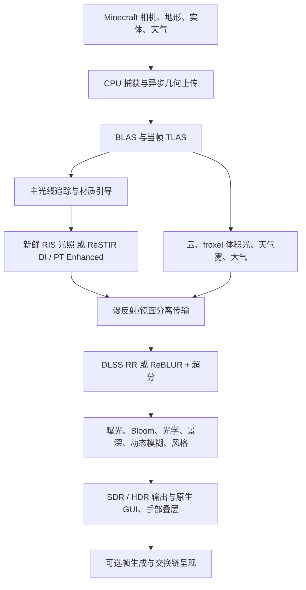

# Caustica Enhanced 技术报告

**目标：** Minecraft 26.2 · Fabric · Vulkan　**日期：** 2026-10-18
**语言：** 简体中文（[English](TECHNICAL_REPORT.md)）

本报告只描述本源码树中**已经实现**的内容：算法、数据流、接口、资源归属与默认值。它不包含路线图、愿望清单或变更历史。功能名称指"可选择的实现"，并不断言与任何其他渲染器输出一致或性能相当。数字均来自源码、默认配置或构建记录，并标明出处文件。

> **验证状态（先读这一条）：** 本源码树已通过完整构建与 Java 单元测试（66 个测试类 / 231 项，2 项跳过）；着色器已离线编译并通过 `spirv-val`。**这一构建没有在 GPU 或游戏内运行验证。** 本文不包含任何帧率或画质测量结论。详见第 26 节。

---

## 目录

1. 定位与规模
2. 平台与依赖
3. 设备要求与兼容策略
4. 帧架构
5. 几何、加速结构与坐标
6. 材质系统
7. PBR 视差
8. 采样与光源采样
9. ReSTIR：Off / DI / PT Enhanced
10. 漫反射/镜面信号与重建
11. 间接缓存：Radiance Cache 与 SHARC
12. 双手动态光源
13. 天空、天体与星空
14. 云、体积光、雾与天气
15. 水面
16. 电介质、玻璃与色散
17. 植被、粒子与实体
18. 远景地形：Voxy 与 Distant Horizons
19. 曝光、相机光学与后处理
20. 色彩管线、视觉风格与 HDR
21. 超分辨率、降噪、帧生成与 Reflex
22. 着色器编译、管线缓存与加载覆盖层
23. 效率与诊断
24. 界面、配置与实例目录
25. 专业离线摄影
26. 构建、测试与验证范围
27. 源码地图
28. 来源与许可

---

## 1. 定位与规模

Caustica Enhanced 是一个**客户端**硬件光线追踪渲染器，集成在 Minecraft 的 Vulkan 图形后端中。它捕获 Minecraft 的地形与动态渲染提交，构建加速结构，估计光传输，重建带噪信号，并输出 SDR 或 HDR 图像，同时保留原版 GUI。

| 系统 | 职责 |
| --- | --- |
| 世界传输 | 主可见性、漫反射/光泽反射、透射、自发光表面、环境光与局部光 |
| 重采样 | 始终开启的新鲜 RIS 光照；可选 ReSTIR DI 或 ReSTIR PT Enhanced |
| 重建 | DLSS Ray Reconstruction；或 NRD ReBLUR + DLSS/FSR/XeSS 上采样 |
| 材质 | 图集与实体纹理、LabPBR、高度场视差、资源包材质覆盖、电介质与色散 |
| 远景 | Voxy 或 Distant Horizons 数据转换为可追踪的 Vulkan 几何 |
| 大气 | Hillaire 天空 LUT、天体圆盘、星空、Radiance 云、froxel 体积光、天气雾、末地环境、极光、彩虹 |
| 相机/显示 | 曝光、Bloom、光学源跟踪、景深、动态模糊、视觉风格、ACES 2.0 SDR/HDR |
| 呈现 | 原生 GUI 合成、Reflex、可选 2×–4× 帧生成（DLSS / FSR / XeSS） |
| 离线摄影 | 分块累积、最高 7680 像素边长、多种格式与元数据 |

**源码规模（维护者工作区实测，含注释与空行）**

| 部分 | 文件数 | 行数 |
| --- | ---: | ---: |
| 主 Java（`src/main/java`） | 213 | 38,651 |
| 测试 Java（`src/test/java`） | 66 | 3,508 |
| Slang 着色器（`shaders/`） | 139 | 16,680 |
| 原生代码与 GPU 数值测试（`native/`） | 72 个文件 | — |

默认包使用每像素 1 个样本、3 次反弹（`caustica-defaults.toml`）。低样本数依赖有效的重建与历史；仅凭一张低噪点截图不足以证明传输正确。

---

## 2. 平台与依赖

| 项目 | 版本 / 约束 | 来源 |
| --- | --- | --- |
| Minecraft | 26.2 | `fabric.mod.json` |
| Fabric Loader | ≥ 0.19.5（构建使用 0.19.5） | `fabric.mod.json`、`gradle.properties` |
| Fabric API | 0.153.0+26.2 | `gradle.properties` |
| Fabric Loom | 1.17.21 | `gradle.properties` |
| Java | ≥ 25（字节码目标 25；构建用 JDK 26.0.2） | `fabric.mod.json`、`scripts/build.ps1` |
| NVIDIA NGX/DLSS | 运行时 310.9.16.0，SDK 头文件 310.9.1 | `caustica-ngx-runtime.json` |
| NVIDIA NRD | 4.17.3（ReBLUR） | `native/reconstruction/README.md` |
| NVIDIA NRI | 固定提交，仅用于 NRD 的 Vulkan 集成 | 同上 |
| Intel XeSS | SDK 3.0.2 | 同上 |
| AMD FidelityFX | SDK 1.1.4（`ffx-api` Vulkan 后端，FSR 3.1.4） | 同上 |
| NVIDIA SHARC | 1.8.3.0 着色器实现（`shaders/extern/sharc`） | `THIRD_PARTY_NOTICES.md` |
| Distant Horizons | ≥ 3.3.3（低于此版本被 `breaks` 拒绝） | `fabric.mod.json` |
| Voxy | 精确 0.2.19-beta（其他版本被 `breaks` 拒绝）；Sodium 需另行安装 | `fabric.mod.json` |
| Sodium API | 0.9.2+mc26.2（仅编译期，用于设置页） | `build.gradle` |
| NightConfig | 3.8.3（TOML） | `build.gradle` |

原生重建桥与 NGX 垫片的发行物为 Windows x64；NGX 垫片另有 Linux 构建脚本。Windows 上的验证不代表 Linux 重建运行时兼容。DLSS 与 DLSS 帧生成需要受支持的 NVIDIA 硬件；3×/4× 多帧生成需要 RTX 50 / Blackwell 级硬件，项目把生成帧数固定上限为 3（即 4×），并未实现动态多帧生成。

---

## 3. 设备要求与兼容策略

**必需的 Vulkan 特性**（缺一则不启用光追，`RtDeviceBringup.REQUIRED_RT_FEATURES`）：`bufferDeviceAddress`、`runtimeDescriptorArray`、`shaderSampledImageArrayNonUniformIndexing`、`descriptorBindingPartiallyBound`、`descriptorBindingSampledImageUpdateAfterBind`、`shaderInt64`、`accelerationStructure`、`rayTracingPipeline`、`rayTracingPositionFetch`、`rayQuery`。

**可选能力**（存在才启用）：

| 能力 | 用途 |
| --- | --- |
| `VK_EXT_ray_tracing_invocation_reorder`（SER） | 选用 `indirect_ser.rgen`，否则 `indirect.rgen` |
| `VK_EXT_opacity_micromap`（OMM） | 镂空几何不透明度微图，受配置开关控制 |
| `VK_NV_low_latency2` + `VK_KHR_present_id` | Reflex 与呈现标记关联 |
| `wideLines` | 方块轮廓线宽度 |

**GPU 分档策略**

- **GeForce RTX 20/30（`RtGpuCompatibility`，按设备名匹配）：** 使用普通 `TraceRay` 与 alpha 测试 any-hit；SER、OMM 与 DLSS 帧生成关闭；DLSS Ray Reconstruction 保持可用。DLSS 帧生成在这些 GPU 上仅当用户自行在 Java 可执行文件旁安装了第三方"SM86 解锁包"时才允许（`RtDlssgUnlock` 只做存在性检测，从不打包、下载或修改该包）。
- **非 NVIDIA（`RtReconstructionPolicy`）：** 超分只提供 FSR，降噪固定为 NRD ReBLUR。
- **帧生成默认提供者（`RtFrameGenerationPolicy`）：** 设备名匹配 RTX 40/50 → DLSS；其余 → XeSS。生成帧数 = `clamp(请求, 1, clamp(设备支持, 1, 3))`。

---

## 4. 帧架构

`RtComposite`（约 2,680 行）协调整帧；`RtContext` 持有设备级分配、队列、编译器缓存与提交辅助；地形/实体模块拥有几何及其世代；DI、PT、缓存与体积各有专属对象；原生重建封装对象持有特性实例，直到空闲安全的销毁边界。

**世界管线**（`RtComposite.startWorldPipelineCompile`）由 **16 个 ray-generation 阶段**、2 个 miss（`sky`、`guide`）、`closest_hit`、`any_hit` 组成：

| 序号 | 阶段 | 作用 |
| ---: | --- | --- |
| 0 | `primary.rgen` | 主光线、材质引导、路径段队列 |
| 1 | `indirect.rgen`（或 `indirect_ser`） | 间接传输 |
| 2 | `restir_temporal.rgen` | ReSTIR DI 时间复用 |
| 3 | `indirect_rr` | DLSS RR 契约下的间接传输 |
| 4–5 | `volume_direct` / `volume_indirect` | froxel 直射/间接体积光 |
| 6–7 | `indirect_cache` / `indirect_cache_rr` | 带间接缓存的传输 |
| 8 | `starfield_composite` | 星空合成 |
| 9–13 | `restir_pt_initial / temporal / shifts / spatial / resolve` | ReSTIR PT 五阶段 |
| 14 | `offline_accumulate` | 离线摄影累积 |
| 15 | `restir_pt_duplicates` | 重复种子图，供下一帧时间复用 |

序号 9–13 与 15 仅在选中 ReSTIR PT 时编译，否则用一个极小占位着色器保持阶段索引稳定；首次切换到 PT 会重建管线一次并显示进度面板（第 22 节）。

着色器结构与描述符声明在构建期由 `buildSrc` 的 Groovy 任务读取 Slang 反射生成匹配的 Java 记录（`generateShaderRecords`、`generateRtBindings`），避免手写布局漂移。世界参数通过设备地址读取（`worldPush = ConstPtr<WorldPush>(pc.worldPushAddr)[0]`），Vulkan 推送常量块只承载热字段与地址，因此不依赖设备支持异常大的推送常量。每帧缓冲环保证已提交数据在可回收前保持不可变。

---

## 5. 几何、加速结构与坐标

- **近景地形**使用捕获的方块模型几何（`RtSectionBuilder`、`RtTerrainMesher`、`RtFluidMesher`）。分段网格可异步构建与上传；默认每 tick 派发 64 个、接收 64 个结果，流式预算 1.5 ms（上限 6 ms，回退 8 ms），在途分段上限 192。
- **BLAS 压缩**默认开启（`terrain.blas-compaction = true`）。
- **实体与方块实体**：默认最多 1024 个实体；方块实体视距 8 个区块、每帧最多构建 8 个；纹理页上限 256。动态实体几何在拓扑兼容时 **refit**，每 120 次重建一次（`entities.refit.rebuild-interval`）。
- **TLAS** 描述当帧实例集合。`RtTlasUpdatePolicy`：实例数不变且连续 refit 少于 32 次才允许 refit，否则重建。
- **OMM**：默认开启，细分级别 4（`omm.subdivision`）；不支持时走普通追踪路径。
- **坐标重基**：世界位置围绕相机重基（默认 128 方块，`terrain.rebase-distance-blocks`）以保持浮点精度；相机位置在 CPU 端为双精度，先相减再转 float。上一帧变换与重基偏移必须描述与当前帧相同的物理点，因此相机相对坐标不作为持久世界标识。
- **区块出现方式**：Instant（原版）、Fade（改变覆盖率而非把颜色乘向黑色）、Rise From Horizon（垂直移动并为运动向量记录上一帧变换，含卸载运动）。追踪透明度是随机的，经重建后才平滑，并非排序 alpha 混合。
- 被已提交工作引用的资源仅在对应完成边界后回收；尺寸、图集绑定、管线形状或原生特性变更使用显式生命周期处理。

---

## 6. 材质系统

**注册与读取。** `RtMaterialRegistry` 为图集精灵和实体纹理页分配快照内稳定的材质 ID。传输读取基础色、alpha、法线、粗糙度、金属度与自发光，遵循 LabPBR 约定与项目材质分类。镂空透明在命中路径中测试；水、玻璃、粒子等有专门行为。更换资源包会使图集/材质绑定及相关历史失效。

**资源包材质覆盖**（`RtMaterialOverrides`，`assets/<ns>/materials/*.json`，`format = 2`）：按 `sprite`（可选再加 `block`）匹配，可设置模型、自发光强度（`emission.strength_cd_m2`，单位 cd/m²）、透射折射率（`transmission.ior`）与阿贝数（`transmission.abbe-number`，0–255）。方块+精灵规则优先于仅精灵规则，同级按资源标识符排序；无效规则被记录并忽略。内置示例：火把 6000 cd/m²，另有灵魂火把、铜火把。覆盖优先于 LabPBR 与引擎启发式。

**自发光启发式**（`RtEmissionHeuristic`）：仅对"与发光方块状态关联的精灵"或显式覆盖的精灵，从线性反照率亮度生成掩膜——亮度低于 0.1 的纹素为 0，其余取亮度的 3 次幂再乘覆盖率。`RtEmissionGrid` 把每个精灵归约为 16×16 单元网格（平均预乘辐射 + 权重），地形光源收集器据此在不接触 `NativeImage` 的情况下得到发光面的质心、包围矩形与未稀释的平均辐射。

**电介质折射率**（`RtDielectrics`）：钠钙玻璃 1.52（默认）、水 1.333、冰 1.309（冰、浮冰、蓝冰、霜冰各阶段）。每个电介质都是体积：在界面按 Snell 折射并压入介质栈（深度 2，`medium.slang`），介质消光衰减界面内的路径段；Fresnel 分裂把第二条延续作为数据（`PathSegment`）追踪，而不是实例化第二份路径追踪器。

**共享求值。** 同一已解析接收点或图表被反复需要时复用材质读取与解码，不改变重建所用的材质因子。

---

## 7. PBR 视差

`radiance_parallax.slang` 对纹理空间高度场求交：相机与二次命中同时更新材质坐标与射线距离；锐利纹素遍历支持浮雕墙面；外射可见性射线在接受平坦基面前先测试局部高度场。符合条件的实心高度面进入 any-hit 几何桶，对 alpha 微图保持未知，普通实心保持不透明遍历。射线起点使用几何法线，BRDF 求值保留映射后的着色法线。

- 搜索上限 256 步；深度上限 0.25 个世界米；强度 `materials.parallax-depth` 范围 0–1，**包默认 0.25**，默认开启。
- 真正的镂空植被被排除。
- 这是**有界浮雕映射**：轮廓以及未命中原始面三角形的射线仍需要真实位移几何，本项目不生成。
- **与 ReSTIR DI 的交互：** 位于几何面平面之下的光源不再能照亮浮雕/法线贴图的着色法线（其阴影射线起点在面后并穿过方块逃逸）。该样本在最终着色中被拒绝，并在时间复用阶段从历史中丢弃（`restir_temporal.rgen.slang`：`dot(n,toLight)>0 && dot(几何法线,toLight)<=0 → W=0`），因此不再累积。

---

## 8. 采样与光源采样

**洗牌加扰 Sobol。** `sampling_math.slang` 评估渐进式二维 Sobol 序列，应用基于哈希的嵌套均匀索引洗牌，并对各坐标独立加扰（Burley 的 Owen 加扰实用构造）。种子来自像素与流标识，在序列推进时保持不变；输出为小于 1 的 24 位可表示小数。每条路径流获得独立的填充二维序列。名为 `stbnSample` 的辅助函数目前取值自这套 Sobol 实现（例如 froxel 直射体积的切片抖动使用它），因此该名字**不能**被理解为每次抽样都使用经单独优化的时空蓝噪声纹理。NVIDIA STBN 标量体积（128×128×64，`resources/caustica/sampling/stbn-scalar.bin`，许可见 `LICENSE-STBN.txt`）由 `RtSampling` 上传，并以设备地址 `stbnAddr` 出现在世界参数中。

**新鲜 RIS 与发射体选择。** 方块发射体采样始终使用至少 **8 个新鲜 RIS 候选**（`lights.ris-candidates`，范围 8–256），即使 ReSTIR 关闭。发射体层级（`RtLightCollector`、`RtLightGrid`、`RtLightGridManager`、`RtLightHierarchy`、`RtEmitterIndex`、`emitter_sampling.slang`）结合分段选择、发射体选择与表面采样；提议概率、重叠图表支持与可见性共同决定估计量。每个发射体/几何世代携带稳定标识（`RtEmitterIdentity`），重建、移除与世界纪元使过期样本失效。能量恰为零的候选可以跳过无用阴影查询，而不丢弃其候选质量、不改变随机流推进。

**光源提议。** 发射体点提议按自适应混合 PDF 混合"均匀面积"与"接收点导向的余弦/GGX"采样；小而远的漫反射提议保留纯面积采样；偏心镜面峰值保留方向覆盖；有限 GGX 直接光照与其可见法线提议匹配；RIS 已覆盖的列表发射体不会被漫反射/有限 GGX 延续路径重复计数；精确镜面、电介质与未列入的发射体保留其可见发光。

---

## 9. ReSTIR：Off / DI / PT Enhanced

界面把 **Off / ReSTIR DI / ReSTIR PT Enhanced** 呈现为互斥单选（`lights.restir-di`、`lights.restir-pt`）。

### 9.1 ReSTIR DI

DI 储备池存储被选光样本、累计权重与样本质量。流程：

1. **初始候选**（`restir_temporal.rgen`）：仅对不透明、非运动、粗糙度 ≥ 0.08 且有漫反射的主表面。候选数 ≥ 8；当候选 ≥ 4、光源数 ≥ 16 且天体照度（ACEScg 亮度）< 1.0（弱光场景）时增加 4（上限 32）。
2. **去遮挡增强**：像素没有兼容历史时候选数加倍（上限 32），以数帧收敛而不是缓慢爬升。
3. **时间复用**：验证上一帧接收点与发射体标识；兼容判定要求法线点积 > 0.94、位置落在深度相关阈值内、平面距离、粗糙度差 < 0.15、漫反射颜色差与 SSS 差。置信度（样本质量 M）被限制，空间聚合结果绝不写入时间历史。
4. **可见性复用**：已解析样本若发射体不可达，则 `W = 0`（保留其 M 在分母中使估计量无偏，同时让被遮挡光从之后所有合并中消失）；每个像素为此多发一条阴影射线。
5. **空间复用 v2**（移植自 Radiance 0.1.6 的思路，`restir_di.slang`）：Fibonacci 螺旋选取供体，半径 24 像素；稳定像素 4 个样本、去遮挡像素（置信度 ≤ 1.25）8 个样本；按法线（点积 > 0.9）、平面距离与随足迹缩放的切向容差匹配；按置信度渐变加权；单个供体贡献不得超过第二大贡献的 8 倍；合并计数上限稳定 6、去遮挡 4。采用源—目标 MIS，避免邻域 BRDF 支持不同导致变暗。
6. **最终着色**重新在当前表面评估被选光，包括真实阴影查询——储备池权重不能替代当前接收点的 BRDF 与阴影。
7. **RIS 目标**使用通道均值标量以降低色度噪声。

选择 ReSTIR DI 会**同时把间接缓存切换为 SHARC**（取代 Radiance Cache）并刷新相关开关。

### 9.2 ReSTIR PT Enhanced

PT 管线依次派发：**初始候选 → 时间复用 → 互易路径平移（shifts）→ 空间复用 → 解析（resolve）**，并有 `restir_pt_duplicates` 统计重复种子。储备池包含重放种子、重连状态、被积函数、PDF、路径标志与复用元数据。平移映射重放兼容路径段，在当前接收点重连，计算 Jacobian 并强制支持/可见性条件。配对邻域表（`paired-neighbors-3-16.payload`，393,216 字节，加载时展开为 32 位）与**基于重复计数的时间 M 上限**管理相关性。重连与概率补偿保持开启。

已提交的历史不可变；活动复用使用暂存银行，只有对应帧完成后才交换接受的历史。尺寸、几何世代、相机历史或模式不兼容时重置复用。手持直接光照在重放时重新求值，而不是把旧的手持样本当作静态场景发光。

**显存（`RtRestirPt.java`，逐像素字节）：**

| 缓冲 | 每像素字节 |
| --- | ---: |
| 储备池 ×3（144 B） | 432 |
| 主表面 ×2（48 B） | 96 |
| 互易平移记录 ×3（48 B） | 144 |
| 新鲜残差 | 16 |
| 命中距离 | 8 |
| 样本 ID | 4 |
| 重复计数 | 4 |
| 解耦辐射 + 解耦漫反射 | 16 + 16 |
| **合计** | **736** |

按内部分辨率 1920×1080 计算约 **1.42 GiB**，尚未计入参数缓冲、配对表、图像、原生重建与加速结构。内部分辨率因此对显存影响极大。没有实现状态压缩。

适配器使用 Caustica 的材质模型，而非参考渲染器的全部 OpenPBR 特性；噪声、收敛与重放成本取决于场景与预算。

---

## 10. 漫反射/镜面信号与重建

传输在**路径求值过程中**按第一个散射波瓣分离贡献，而不是事后按猜测的材质比例拆分最终 RGB。随机波瓣选择保留其概率补偿。可见天空、直接可见发光与不受支持的透明主表面是独立的合成项。

| 信号 | 含义 |
| --- | --- |
| 漫反射辐射 | 与第一漫反射散射分量相关的传输 |
| 镜面辐射 | 与第一反射分量相关的传输 |
| 命中距离 | 波瓣专用有效传输距离，按所选重建契约编码 |
| 材质因子 | 分离的漫反射/镜面再调制因子 |
| 引导 | 深度、世界法线、线性粗糙度、运动、置信度 |
| 旁路 | 独立的天空/发光/不支持透明前缀信号 |

### 10.1 NRD ReBLUR 路径

普通 NRD 前端选择 `REBLUR_DIFFUSE_SPECULAR`；原生桥保留 RELAX 的实现，但不作为用户可选项暴露（配置键 `reconstruction.nrd-method`）。输入按对应材质因子解调、独立降噪、再重调制。使用 NRD 的 YCoCg 打包与归一化命中距离辅助函数，参数 **A = 3、B = 0.1、C = 20**；漫反射距离归一化用粗糙度 1，镜面用材质粗糙度。0 表示未采样波瓣；没有追踪延续的纯直接光使用哨兵值 **60000** 作为显式近似。

深度为正的视空间深度；法线编码匹配所构建的 NRD RGBA16 配置；粗糙度为线性（非 GGX alpha）；运动为纹理像素单位的"上一帧减当前帧"、不含抖动的位移。NRD 的投影约定对整个裁剪空间 Y 行取负，上一帧视图平移考虑坐标重基。历史重置使用当前矩阵/抖动作为上一帧并请求清除重启。

ABI 提供九条图像记录（漫反射/距离、镜面/距离、深度、法线/粗糙度、运动、已滤波漫反射、已滤波镜面、两个置信度输入），每条 32 字节；ABI 边界使用 GENERAL 布局，采样输入按需转换并在之后恢复。

### 10.2 DLSS Ray Reconstruction 与时间上采样器

DLSS RR（`RtDlssRr`）使用其自己的 NGX 输入契约（路径追踪颜色 + 法线/粗糙度、漫反射/镜面反照率、深度、运动、反射运动向量），在一次通道内完成降噪与上采样，**不使用** NRD 的 YCoCg 缓冲。模型预设可选 Auto / D / E / F（F = "RR2 / DLSS 4.5"），包默认 F；质量档含 Performance / Balanced / Quality / Ultra Performance / Native AA（DLAA），包默认 Performance。

FSR 与 XeSS 路线使用 ReBLUR，不能与 RR 同时使用。重建/提供者变更会重建不兼容的特性并重置历史；界面可用性遵循此策略，不提供可编辑的降噪器选择器。只有特性初始化成功才使用重建输出。

---

## 11. 间接缓存：Radiance Cache 与 SHARC

**Radiance Cache** 与 **SHARC** 互斥（`indirect-cache.provider = off | radiance | sharc`，包默认 off）。漫反射查找不会悄悄替代无关的镜面传输；缓存未命中、置信度不足或数据无效时回退到追踪。

- Radiance Cache（`RtRadianceCache`）累积并解析带样本数、置信度与过期的空间辐射估计；黑色训练样本同样计数；新鲜零累加器仅在存在有效正历史时避免多余的解析写入，过期条目仍会被清除。
- SHARC 使用基于哈希的空间辐射缓存及路径更新/解析/查询阶段（`shaders/extern/sharc`，NVIDIA RTXGI，版本固定于第三方声明）。
- 失效由持久世界坐标、场景纪元、光照与几何变化、重基与尺寸变化决定。末地的动画照明下禁用间接缓存存储。

---

## 12. 双手动态光源

`RtHeldLight` 从手持方块的默认状态推导发光（含模组方块物品）；显式的非方块配置覆盖熔岩桶、烈焰棒类、荧石粉、发光墨囊、发光浆果等；暗物品贡献为零。灵魂、红石、暖色、海晶灯等固定调色板提供**线性 BT.709** 色调，传输前转换为 **ACEScg**。

主手与副手产生两个独立的解析光源，考虑玩家惯用手和当前相机朝向；位置在浮点存储前重基；精确打包的历史键区分两个"等级/调色板"组合，避免浮点哈希碰撞；光源移动、替换与湿表面变化会降低不兼容的时间置信度。

入射项（`handheldIncident`，`world_common.slang`）：对距离 `d`，`color × level × 3 × falloff / max(d², 0.36)`，其中 `falloff = 1 − smoothstep(8, 12, d)`，12 米以外为零。受光量由当前表面朝向、材质响应与真实阴影连接决定（`shadeHeldSource` 发射阴影射线）。这是**有界的艺术化点光源近似**，不是完整网格光，也不覆盖远程玩家的物品光。

第一人称物品在世界重建之后的原生分辨率手部叠层中绘制；其方块光照贴图分量被抬升到物品发光等级而保留环境天光。捕获的自发光物品几何使用"仅主光线"发光标志，避免二次传输重复计算解析光源。手部叠层不会成为自动对焦目标，且只对主光线可见——不投射二次射线阴影，也不通过手持解析光照亮周围场景。

---

## 13. 天空、天体与星空

- **Hillaire 大气 LUT**：透射率、多重散射与视角相关天空辐射（`pipelines/sky_lut/*`，Rayleigh/Mie/臭氧）。太阳/月亮方向、时间、天气与曝光影响图像。
- **有限距离空气透视**：把同一天空模型延伸到相机—表面的有限距离（含远景地形），4/6/8 段解析积分随距离选择，中点方向/向上可见性探针；使用天空模型的"100 世界方块 = 1 千米"尺度；作用于有天空光的维度，跳过水下相机与天空 miss 以免重复积分。中点探针只近似沿段可见性，不是逐步大气阴影求解。
- **天体圆盘**：圆形太阳/月亮开关、尺寸倍率 0.25–4（光照不变，月相不变）、月光倍率 0–2；物理常量在外观包中（太阳 128,000 lux、月亮 0.35 lux、夜空辉光 0.0008 cd/m²、星光 10 cd/m²、太阳/月亮角半径 0.6° / 1.5°，见第 20 节）。
- **星空**：`prime_starmap*.slang` 对 NASA Deep Star Maps（BC6H，16384×8192，15 级 mip，经 `devtools/decode_prime_starmap.py` 校验解包为 `prime-starmap.bin`）做足迹/极点滤波，把线性 Rec.2020 辐射转换到工作色彩空间。云/天气衰减与日光决定可见性，开启星空不会让星星穿透不透明云。
- **夜间极光**（`overworld_sky_effects.slang`）：晴朗主世界夜晚的分层绿/紫噪声脊极光；月光降低其亮度，柔和亮度上限防止暗场景曝光下喧宾夺主。哈希使用整数格点（PCG），避免远离原点时正弦哈希精度丢失造成闪烁。
- **彩虹**：雨后太阳高度角低时出现反太阳彩虹，外缘红、内缘紫；天空湿度历史独立于"雨湿地面"开关，并在分块摄影期间一致冻结。极光与彩虹共享天空 miss 与反射的环境求值器，现有体积传输可遮挡它们。

---

## 14. 云、体积光、雾与天气

**云。** 模式 **Off / Vanilla / Radiance**（包默认 Off）。Radiance 云使用分层密度剖面、体积积分与噪声资源（`radiance/cloud-noise.bin`），云阴影与 BVH 参与可独立开关：BVH 选项插入过程式云包围体并在阴影遍历时评估密度，不生成不透明云网格；相机与反射中的云（含天体圆盘衰减）独立于世界阴影开关。天气平滑驱动阴天覆盖/密度；地平线混合与层相交避免人为截断；云噪声与云照明独立，夜间照明不会复用白天的白色散射光源。阴天云传输把光学厚度乘以最多 3.5（自照明与地形/云阴影路径同样使用增大的消光）。

**体积光。** 界面为开/关；配置保留 `default` 与 `radiance` 两种实现（`volumetric.light-mode`）。Radiance 模式使用相机对齐 froxel：

- 直射网格 256×128×64（含世界可见性查询与当前天体光谱）；间接网格 128×64×32（天空与天体照亮漫反射表面的相函数采样，两次表面反弹；人工发光体不注入大气信号）。
- 非线性切片覆盖 50 方块；棋盘更新、重投影历史、空间滤波与解析段积分降低重复工作。
- 历史上限：直射 16，间接 **64**；相机不连续、世界/介质/光照变化使不合适的历史失效；累计积分在可见表面深度采样；水体吸收单独保留以免重复应用；透明命中终止漫反射间接探针。存储 float32，激活时体积网格约 136 MiB；网格范围之外使用常介质延续近似。
- **空气相函数：** 气溶胶 Henyey–Greenstein + Rayleigh 波瓣（保能量），使光柱色调偏离太阳前向峰；散射样本在 froxel 柱内抖动并保持在裁剪该切片的表面之前；默认（非 froxel）行进使用同一空气相函数。
- 雾强度同时控制局部液滴密度与有限距离 Rayleigh/Mie 雾霾；froxel 与回退行进读取相同的空气系数。水下散射缩放至先前值的约 30%，消光与水吸收不变。

**天气雾**可独立开关：雨/雷暴与清晨条件激活高度相关介质，具有连续世界噪声、屋顶/暴露拒绝和视线段透射，共享已有 froxel 积分，而不是均匀屏幕色覆盖。主世界的日常薄雾在黎明、黄昏与夜晚存在、正午缺席，海平面梯度保持高山峰顶清澈；噪声使用整数世界锚点，重基不会移动场；地形暴露与相机深度支持压制屋顶下和深洞中的薄雾。

**雨与湿润。** 按世界列追踪雨暴露并随区块失效；湿润材质调整粗糙度/反射与适合暴露表面的积水响应（屋顶覆盖与垂直面区别处理）；折射/散射雨粒子与原版地面溅水粒子对场景深度合成。水滴广告牌保持中心与运动但只用捕获宽高的四分之一，随机纹理覆盖（峰值 alpha < 0.5，平均覆盖 < 0.2），中性接收反照率被衰减，避免强光下出现大块纯白圆盘。湿度变化会降低无效镜面历史。**屏幕镜头雨滴层未实现。**

**末地环境**（`end_environment.slang`、`end_material.slang`）：远处环境、内部光与薄雾共用紫色调板。光束使用三倍频的世界 XZ 噪声、以 Y=68 为中心的柔和高度包络与 24 步加权加性视线积分，使用绝对世界坐标与冻结场景时间，因此视图、反射与离线分块共享同一图案。可见漩涡是低基础密度的世界空间参与介质（垂直噪声拉伸、约 1/72 弧度/方块的随高度旋转、侵蚀、中央空腔与环形缝隙）；视线使用 32 个非均匀步、最长 650 方块，Beer–Lambert 积分在第一个真实表面处裁剪；三个朝向内部点光的密度探针近似自阴影，并带有有界彩色多重散射；中心区域之外的世界单元闪光源贡献品红照明（计时器与位置是冻结场景时间的确定性函数，不生成闪电几何）。同一点光源与介质阴影函数通过几何可见性与现有 BSDF 照亮不透明表面；ReSTIR PT 把它作为新鲜解析残差光照求值，而不是向储备池插入伪静态发射体。

---

## 15. 水面

模式 **Performance / Balanced / Quality**（包默认 Performance，`water.mode`）。水面几何保持平坦，只有法线倾斜（梯度波谱）；折射使用 IOR 1.333（空气→水不会全反射），介质按群系色调做逐通道 Beer–Lambert 消光（`WATER_DENSITY = 0.1`，蓝色海洋色调红通道吸收最快，沼泽绿棕色偏移色相）。焦散通过对同一波场微分得到，因此与可见涟漪同步。

| 模式 | 波谱实现 |
| --- | --- |
| Performance | 归档的 Distance-Update-v5 波剖面，16 个分量。每分量常量来自 16 项常量表；不再使用依赖 `frac(sin(i·127.1+19.19)·43758.5453)` 的随机数（其结果随 GPU 的 `sin` 精度而变），改用一次性以 float32 求值的表，使所有 GPU 的朝向扩散、相位与波长一致；重复的 sin/cos 合并为 `sincos`。焦散每个采样点求值该谱四次，因此收益最大。 |
| Balanced | 归档的 v11 实现（`water_v11.slang`） |
| Quality | 当前 32 分量方向波谱：尖峰波形 `h = a·exp(S·(sin φ − 1))`、重力—毛细色散 `ω = √(g·k + (σ/ρ)·k³)`（长涌浪传播、短波近乎原地抖动）、风向 + 蜿蜒（朝向围绕固定风向扩散，最大分量的相位沿波峰调制）、整数 PCG 种子使各 GPU 一致；所有只依赖分量索引的常量（波数、角频率、朝向、扰动、振幅包络）已制成常量表 |

另有波浪 LOD 权重 `waterWaveLodWeight`（按像素足迹淡出子像素波长）、水溅射粒子（`RtWaterSplash`）以及世界锚定的波场（图案固定在世界空间）。

---

## 16. 电介质、玻璃与色散

玻璃/冰/水等为折射体积（第 6 节）。**色散**（`materials.dispersion`，默认关；强度 0–8）使用三波段（红 0.6563 µm、黄 0.5876 µm、蓝 0.4861 µm）Cauchy 型折射率差：`n_band = n_ref + (n_ref − 1)·差值·强度/阿贝数`；传输保持线性 ACEScg，波段投影使用 Rec.709 原色，每条路径随机选择一个波段（`dispersionSeedBand`）。阿贝数由材质覆盖的 `transmission.abbe-number` 提供，为 0 则无色散。

---

## 17. 植被、粒子与实体

- **植被形变**适用于受支持的草、树叶、花与水生植物（`vegetation.slang`）：稳定的世界空间相位使相邻方块不同步；运动限制在授权精灵矩形内，因此图集邻居和 BLAS 边界都不泄漏；使用上一时刻形变作为运动对应。主光线与阴影光线的材质 alpha 与形变需一致，避免脱离的阴影或时间拖影。LOD 体素地形不复现近景植物的每个动画。
- **粒子**作为相机射线广告牌绘制在追踪场景内（默认最多 1024 个）；雨溅射使用专用基元标志。
- **实体**：实体与方块实体并入光追场景；发光轮廓、名牌与方块轮廓以叠层管线绘制（`rt/overlay`）；可隐藏第一人称身体（`entities.hide-player`，默认开）。第一人称玩家几何对所有射线类型省略（手与手持物仅对主光线可见）。
- **有生命实体**的图元通过材质引导与光学高光选择传播资格标记：其可见发光被保留，但衍射和散焦衍射忽略带标记的光源。

---

## 18. 远景地形：Voxy 与 Distant Horizons

提供者选择（`terrain.lod-provider`）只列出**已安装**的提供者：`voxy`、`dh`、`off`；默认取第一项（装了 Voxy 用 Voxy，否则 DH，否则关）。同一时间只有一个提供者供给地形。近景保留完整方块几何；提供者 LOD 本质上是近似。仅当 Vulkan 后端且光追开启时，Caustica 才接管 Distant Horizons 的光栅通道（`LodRasterPolicy`），否则 DH 保持原样。

**Voxy：** 保留其存储/摄入引擎；Caustica 获取快照并构建独立的 Vulkan 几何，在 Vulkan 下禁用 Voxy 的 OpenGL 渲染器。面使用当前资源包图集、存储的群系着色与材质 ID；镂空保留 alpha，水保留群系分类。紧凑 GPU 顶点属性为 8 字节，命中时的面 UV 投影避免展开的逐三角形 UV 存储。近景法线/视差贴图不应用于远景体素。一方块体素精度至少延伸 512 米，更粗层级随距离过渡；距离由 Voxy 的 512 方块分段换算并以 512 个区块封顶。

**资源控制：** 一个快照工作线程，每批最多 64 个新列，每 250 ms 调度；未见根节点先于缺失数据重试，缺失数据 5 秒后重试；保留的 CPU 网格预算 **64 MiB**、每列 8 MiB，另有 GPU 余量检查；贪心合并与六向邻面快照抑制内部面；水界面保留浸没的不透明表面；粗糙父网格保留到所需更细几何完成 GPU 上传后才退役；附近详细上传优先于粗略包围网格。这些上限不含 Voxy 自身存储缓存、整个 Java 堆、Minecraft 分配或原生重建内存。

**Distant Horizons：** 通过 `DhBridge`/`DhRenderApi` 获取其网格；提供者选择与光栅接管由 `LodProviderPolicy`、`LodRasterPolicy` 决定；`overlay.dh-progress` 控制加载进度叠层（默认开）。

远景光照使用降成本路径，保留提供者几何与基础材质，但无法恢复提供者缺失的细节。Voxy 提供的是**已访问/已导入**地形，不能让未知区块存在；距离设置不证明所请求的地形已全部填充。

---

## 19. 曝光、相机光学与后处理

**显示通道顺序**（`display/main.comp.slang`）：镜头场景（畸变）→ 雨 → 乘曝光 → 加 Bloom → 加光学源衍射与电影眩光 → 镜头收尾（色差、暗角、颗粒）→ 外观包 LMT → 视觉风格 → ACES 2.0 输出变换（SDR/HDR）。

**曝光**（`exposure_hist`/`exposure_resolve` + `RtExposure`）：自动模式使用直方图百分位测光（低 0.5、高 0.95）、中心权重（σ = 0.35，下限 0.15）、天空权重上限 0.25、发光权重上限 0.1，把场景以 EV100 度量后经外观包的"EV100 → 补偿 EV"曲线（默认控制点 −2:−3、2:−2、8:0、15:1，范围 −15 … −2 EV）得到渲染偏移，再做非对称时间适应（变暗 2.0 s、变亮 0.4 s，在 EV 空间应用）；配置项 `min-ev` / `max-ev`（包默认 −1.5 / 2.0）是绝对曝光倍率的护栏；支持预曝光。手动模式使用 `manual-ev`（−15 … +15）。调试视图含曝光伪彩色与测光权重。

**景深**（默认关）：光圈刻度 f/1.4 – f/22（滑块，默认 f/1.4）；"物理"散焦（默认）从投影与 36 mm 传感器宽度推出焦距，在相机相对米单位中重建轴向深度，求有符号薄透镜弥散圆；归一化 64–384 采样圆盘聚集按源的光圈覆盖与足迹面积加权，在重建与动态模糊之后、色调映射之前于场景线性 HDR 中进行；前景支持可延伸到更清晰的背景，背景支持在更清晰前景接收点处受限；足迹上限 96 输出像素。高斯为备选散焦。自动对焦读取准星处世界深度，排除第一人称手部，GPU 持久焦点状态平滑过渡。这是有限的屏幕空间近似，单深度聚集看不到被遮挡的背景几何。

**动态模糊**（默认开）：基于运动引导，采样 8–64（默认 24）、快门角 0–360°（默认 180）、最大半径 1–128 像素（默认 32，随输出分辨率缩放）、强度 0–2。从重建后的全分辨率图像用硬件线性滤波采样；前景速度扩张到邻近轮廓，最终聚集按实际覆盖加权；亚像素运动平滑淡入；运动历史独立于重建历史容忍更长帧间隔。

**Bloom**：金字塔（外观包指定层级数，默认 6）、阈值（场景线性 2.0）、软膝 0.25、半径；用户强度 0–3（默认 1.0）。

**镜头光学：** 八边形光圈 FFT 在 48 个波长上积分，经 2.6 纹素传感器足迹滤波，积分亮度为 1（`tools/bake_optics_psf.py` 生成 `aperture-psf.f32`）。最多 16 个源参与：在半分辨率高光场的 4×4 网格中测量后跨帧跟踪，发射体像素在抖动补偿坐标读取，位置取亮核的支持加权质心；匹配时用深度与相机矩阵重投影，因此相机运动被精确消除而只过滤测量噪声（位置约 100 ms、强度与尺寸约 55 ms）；每轨迹的残余运动跟随自身移动的光源，视角锁定光源（如手持光）直接在屏幕空间匹配；大变化立即跟随，未匹配的轨迹滑行并在数帧内淡出；鬼影与光晕跟随一个主源，仅当另一个源亮 30% 时才切换。日间曝光亮度软膝 6–18、夜间 16–48。控制项：鬼影、光晕、变形拉丝、衍射星、棱镜漏光、光谱镜头色（波长相关的炫光与衍射）、电影炫光强度（0 关闭）、色差、暗角、畸变、颗粒。八条衍射射线旋转 22.5°；可见的有生命发光体与月亮圆盘不激发衍射（月亮排除覆盖当前到上一帧的扫掠投影）。冻结的离线照片保留自己的单通道光源选择。

---

## 20. 色彩管线、视觉风格与 HDR

**场景单位**（`RtSceneUnits`）：**场景值 1.0 = 1 cd/m²（nit）**，这是定义而非调节项；光照常量据此编写（太阳约 100,000 lux、满月约 0.25 lux、火把火焰约 15,000 cd/m²），便于对照公开光度数据。渲染器是 RGB 而非光谱，"亮度"指存储的 ACEScg 三元组的 AP1/D60 Y。测光与曝光补偿曲线运行在 **EV100** 刻度上：`EV100 = log2(8·L)`，L 单位 cd/m²。

**外观包**（`RtLookPackage`，schema 4，随包资源 `caustica/color/looks/default/look.json`，不是可变 TOML）：曝光范围 −15 … −2 EV 与曲线锚点、场景参考 LMT（`lmt.bin`）、Bloom 参数，以及光度锚点——太阳照度 128,000 lux、月亮 0.35 lux、方块发光亮度 2,000 cd/m²、夜间辉光 0.0008 cd/m²、星光 10 cd/m²，天空参数（太阳正午向南倾斜 30°、角半径 0.6°/1.5°、圆盘半角 16.7°/11.31°、地面反照率 0.1、地平线柔化 15°）。外观包整体加载，加载失败会在载入时而非缩放时暴露。

**显示变换：** 工作空间为场景线性 **ACEScg**。`tools/bake_display_lut.py` 用 OpenColorIO 内置配置 `cg-config-v4.0.0_aces-v2.0_ocio-v2.5` 烘焙 **ACES 2.0** 输出变换 LUT：SDR（Rec.709、sRGB OETF）一张，HDR（Rec.2020 PQ）四张，峰值 500 / 1000 / 2000 / 4000 nit；LMT 另存为对数到对数的场景参考表，不重复五张输出 LUT。LUT 为提交到仓库的二进制资源。

**视觉风格：** 单一选择器 **Vanilla / GTA VI / Kodak 2383 Inspired**（包默认 GTA VI）。风格在外观包 LMT 之后、共享 ACES 输出之前，于场景线性 ACEScg 应用，对 SDR 与 HDR 相同。
- *Vanilla*：旁路风格变换（共同输出处理仍应用）。
- *GTA VI*：项目自行编写的电影化诠释——阴影略偏冷、高光略偏暖的亮度相关平衡，轻度饱和度整形（深阴影中略降饱和并保留亮部霓虹色度），阴影略压暗。不是对任何商业渲染器的提取。
- *Kodak 2383 Inspired*：更强的亮度相关冷暗部/暖亮部平衡，围绕中灰的对比度（指数 1.18）与克制的高光肩部，RGB 随亮度一起缩放以保持亮光色相。**不是**实测的柯达胶片仿真、校准的印片 LUT，也不使用柯达授权数据。
风格选择不影响物理照明/材质估计。

**HDR：** 需要操作系统/显示器支持与可创建 PQ 交换链的表面。控制项：纸白（默认 200 nit）、UI 亮度（80–500 nit）、峰值（500/1000/2000/4000）、映射（ACES / Reinhard / Linear）、色域（Rec.2020 / Display P3 / Rec.709）。截图可另存 ACEScg EXR（`screenshots.exr-enabled`）。

---

## 21. 超分辨率、降噪、帧生成与 Reflex

**提供者矩阵（`RtReconstructionPolicy`）：** NVIDIA：`dlss`（RR）、`fsr`、`xess`；其他厂商：`fsr`。选择 `dlss` → 降噪器 `rr`，其余 → `nrd`。DLSS 路径使用 NGX（`RtDlssSr`、`RtDlssRr`，`NgxRuntime`）。

**帧生成**（`frame-generation.provider = auto | dlss | fsr | xess`，默认 auto；FG 本身默认关）：

- 倍数表示"1 个真实帧 + 1/2/3 个生成帧"（2×/3×/4×）；配置存生成帧数 `multi-frame-count`（1–3，默认 1）。有效生成数 = min(请求, 驱动能力, 安全呈现容量)；渲染器还查询表面最小/最大图像数并在允许时预留足够交换链图像。UI 变更在 Minecraft 生命周期边界请求交换链重配置。
- **DLSS**（`RtDlssFg`）：每张生成图像有独立输出存储；带索引的 NGX 调用对同一真实帧捆绑接收统一单调 **BackbufferFrameID** 与索引 1…N；所有生成兄弟共享重置状态，仅在捆绑的最后一次求值后清除。
- **FSR**（`RtFsrFg`）：AMD Vulkan 插帧上下文，呈现与 DLSS 呈现引擎共用。
- **XeSS MFG**（`RtXessFgPresent`）：GPU 内 Vulkan/D3D12 共享，XeSS 代理拥有呈现与插帧节奏。
- **呈现引擎**（`RtFramePresenter`）：钩住 Minecraft 帧尾，把生成帧的 Y 翻转 blit 录制进 Minecraft 自己的持久命令编码器，由其一次性 `submit()` 触发呈现信号量；生成帧先于对应真实帧呈现。需要 FIFO 呈现，避免后来的呈现覆盖较早排队的图像；呈现速率计数器必须与真实渲染 FPS 区分。菜单/加载过渡中若没有 RT 快照，真实图像可能被复制并计为回退，而不是插帧结果。
- 不声称有专用的异步光流队列或动态帧节奏调度器。帧生成不会降低着色器成本、CPU 模拟时间或"输入到真实帧"的延迟。

**NVIDIA Reflex**（`RtReflex`，包默认开 + Low Latency Boost）：基于 `vkLatencySleepNV` 时间线信号量的每帧睡眠/节奏与延迟标记；`minimum-interval-us` 限帧（0 = 不限）。设备支持在启动时统一请求，使界面能实时切换。

---

## 22. 着色器编译、管线缓存与加载覆盖层

构建期 Slang 编译产出经校验的 SPIR-V；运行时驱动仍需为实际设备编译/链接 Vulkan 管线——这是两种不同的缓存，出厂 SPIR-V 不能消除首次启动的驱动编译。

- **后台编译：** 世界管线在后台编译线程（"Caustica pipeline compiler"）创建；等待期间原生原版渲染保持活动。设备销毁或图集/管线拆除之前先排空编译器工作，因为进行中的原生编译无法安全取消。
- **PT 阶段按需编译：** 五个 ReSTIR PT 阶段及重复种子阶段（驱动编译最贵的 raygen）仅在选中 PT 时编译；之后首次切到 PT 重建一次并显示进度面板。
- **`RtPipelineCache`：** 驱动/设备范围的不透明缓存存放在实例目录 `Caustica Enhanced/cache/vulkan/<pipelineCacheUUID>-<driverVersion>.bin`；检查厂商/设备 ID、头部与 UUID，大小上限 256 MiB；不兼容或被拒绝的数据回退到空缓存；计算、图形与世界光追管线创建共享该缓存并做主机侧同步；脏标记避免冗余保存；持久化把原生缓冲直接写到临时文件再替换，避免保存时整堆拷贝。
- **加载覆盖层**（`RtShaderLoading`、`ShaderLoadingOverlayMixin`）：用原版字体绘制 "Preparing shaders / Compiling world pipeline (driver) / Saving compiler cache"、已完成阶段与经过秒数。**百分比是基于阶段的估计**：原生编译器只报告阶段边界，驱动阶段以指数逼近 95% 并按本会话上次观测时长缩放，永不超过 97%（失败时显示错误状态约 20 秒）。覆盖层与世界管线预热都只在 `isGameLoadFinished()` 之后进行，避免在原版文字着色器尚不存在时绘制。

---

## 23. 效率与诊断

已实现的成本削减包括：共享接收点/材质解码、复用发射体选择上下文与 PDF、循环不变量外提、零能量阴影拒绝、漫反射缓存归属、复用矩阵/原生参数存储、有界流式批次、BLAS 压缩、实体 refit、贪心 LOD 网格、紧凑 LOD 属性、编译器缓存复用、水面波谱常量表与 PT 阶段按需编译。这些保持预期的传输预算，**不证明**固定的 FPS 提升。

内联射线查询加速受支持的可见性路径；SER/一致性提示与 OMM 取决于设备能力，不受支持的硬件走常规追踪路径。提示不能作为驱动确实重排了工作或降低了寄存器压力的证据。

**诊断：** `RtGpuTimings` 记录图形通道时间戳；`RtBuildGpuTimings` 度量计算队列上的上传/构建批次；`RtTransportCounters` 在启用时统计实际射线、RIS 候选、PDF 工作与重放事件；`RtFrameStats` 输出帧统计；分配器字节、驱动内存预算与主机等待时长分别报告；调试视图含法线、反照率、深度、粗糙度、运动、镜面、镜面运动、曝光伪彩与测光权重。融合进射线派发的材质/内联雾成本无法用命令缓冲时间戳隔离，需要受控消融或 Nsight 着色器分析器；上传/AS 批次可与图形重叠，不能简单与帧时长相加。

---

## 24. 界面、配置与实例目录

设置使用原生 Minecraft 选项控件，并通过 Sodium 设置页 API 与原版视频设置入口接入（`SodiumConfig`、`VideoSettingsScreenMixin`）。分区：Rendering & Performance；Upscaling & Ray Reconstruction；Clouds, Light & Fog；Sun, Moon & Stars；Materials & Water；Color & Exposure；Motion & Depth of Field；Lens Effects；HDR Display；Distant Horizons；Rain and wet surfaces。语言资源含 en_us、zh_cn、zh_tw、ja_jp、ko_kr、de_de、es_es、fr_fr、it_it、pt_br、ru_ru。

**实例数据**位于 `<游戏目录>/Caustica Enhanced/`（`CausticaPaths`）：

| 子目录 | 内容 |
| --- | --- |
| `config/settings.toml` | 运行时设置 |
| `config/offline.json` | 离线摄影偏好 |
| `runtime/nvidia`、`runtime/reconstruction` | 随包原生库的校验副本 |
| `cache/` | 驱动管线缓存 |
| `diagnostics/frame-stats` | 帧统计 |
| `exports/` | 离线摄影导出与 EXR 伴随文件 |
| `migration-conflicts/` | 旧位置文件与新目标冲突时保留的副本 |

首次启动会把旧位置（`config/caustica.toml`、`config/caustica-offline.json`、`caustica-ngx`、`caustica-native`、`.cache/caustica`、`rt-frame-stats`、`screenshots/Caustica-*`）迁入新目录；迁移从不跟随符号链接，路径解析拒绝离开模组目录。

匹配的 `-Dcaustica.*` 系统属性覆盖启动值；`src/main/resources/caustica-defaults.toml` 定义**包默认值**（Java 回退值不一定等于出厂默认）。已存在的用户文件优先；隐藏设置不会从配置中移除，也不会被静默强制覆盖。

**包默认值（`caustica-defaults.toml`）**

| 设置 | 默认 |
| --- | --- |
| 总开关 / 工作线程 | 开 / 4 |
| 样本数 / 反弹数 | 1 / 3 |
| ReSTIR（DI / PT） | 关 / 关；新鲜 RIS 候选 8 |
| 间接缓存 | off（Radiance 与 SHARC 互斥） |
| 超分 / 降噪 | DLSS / RR（预设 F，质量 Performance）；FSR、XeSS 用 ReBLUR |
| 帧生成 | 关；提供者 auto；预设 b；生成帧数 1 |
| Reflex | 开 + Low Latency Boost |
| 远景提供者 | 取已安装的第一个 |
| 区块出现 | Fade |
| 视差 | 开，深度 0.25 |
| 云 | Off；强度 0.5；覆盖 0.25；云阴影开，BVH 关 |
| 体积光 / 雾 | 开 / 开；光强度 0.25 |
| 水 | Performance |
| 视觉风格 / Bloom | GTA VI / 1.0 |
| 景深 | 关；f/1.4；强度 0.5；物理散焦 |
| 动态模糊 / 镜头效果 | 开 / 开 |
| 曝光 | 自动 |
| HDR | 关（纸白 200、UI 200、峰值 1000） |
| 天体 | 极光开、圆日开、圆月开、尺寸 1.0、月光 1.0 |
| 天气 | 雨折射开、湿地面开 |
| 实体 / 粒子 | 开（1024 / 1024），隐藏第一人称身体 |

---

## 25. 专业离线摄影

顶层 **Professional offline rendering** 入口在世界之上的右上角有界面板中打开原生控件（`Y` 开关面板，按住 Alt 操作，Enter 拍摄或取消）；三档面板尺寸使用统一整数帧缓冲像素缩放，文字/控件与点击坐标一致。分类：Output、Camera、Sky、Tracing、Materials（地形/材质）。初值来自当前渲染器；FOV、曝光、天气效果与本地客户端时钟即时预览，时间控制不会向服务器发命令，也不编辑存档时间。冻结相机锁定位置与朝向（仍可调 FOV 与光学参数）；冻结世界停止单人服务器与本地动画（无法暂停远程服务器）。

**范围（`RtOfflineSettings` 校验）：** 宽/高 1–7680 像素；样本 1–16；反弹 2–32；近景区块 2–32；LOD 区块 0–4096（提供者必须已有对应数据）；曝光 ±24 EV；降噪 Off / RR / ReBLUR；DLSS 质量 Native / Quality / Balanced / Performance / Ultra Performance；位深 8/10/12/16；HDR 峰值 100–10000 nit；HDR 映射 ACES / Reinhard / Linear；色域 Rec.709 / Display P3 / Rec.2020 / ACEScg（ACEScg 仅 EXR）。

**输出格式：** PNG、JPEG、TIFF、OpenEXR（半精度线性）、HEIC、AVIF、无损 JPEG XL。HEIC/AVIF 支持 8/10/12 位；PNG/TIFF 把高有效位存入 16 位通道；JPEG 为 8 位 SDR；HDR 栅格输出用 PQ 与所选色域/映射/峰值；HDR 要求非 PNG/JPEG。SDR 色域转换描述已显示映射的颜色，无法恢复其源显示变换裁掉的颜色；EXR 保留所选艺术外观与光学贡献（显示色调映射之前）。HDR 与 EXR 导出另产出真实 16 位 Rec.709/sRGB 的 `.sdr.png`（用相同的风格化场景线性图像与所选 ACES/Reinhard/Linear 肩部），是单独映射的图像而非内嵌增益图。每个文件原子提交，多文件导出不是单个文件系统事务。

**元数据：** 导出内嵌格式支持的元数据，并附完整 `.metadata.json`（时间戳、项目/版本、相机姿态/FOV/对焦、世界时间/维度、实际曝光、全部拍摄设置、样本、反弹、重建模式、分块方案、GPU 与显存、色域、传输函数、精度与映射）。PNG/JPEG/TIFF/AVIF/JXL 携带 XMP；EXR 携带捕获属性；HEIC 把完整快照以带标签的 base64 UTF-8 存于主图描述；在受支持处保留 ICC/CICP/PQ 与峰值亮度标签（CLLI 值是配置界限而非图像内容实测）。

**分块算法：** 自动模式按设备本地显存余量与近期实时帧节奏选择分块核心（256 或 512，在括号内显示），也可自定义 128–1024（32 步长）；方案在整次拍摄中固定；每块四周 32 像素保护边（GPU 历史为核心 + 两侧各 32 像素）。裁剪相机投影追踪正确的整幅胶片区域；全视图对焦先于裁剪锁定；畸变在整幅胶片射线坐标中求值，颗粒与暗角使用整幅胶片坐标；曝光、对焦、相机、动画时钟、天气过渡、已发布地形与手持光源档案在拍摄期间固定。每个降噪分块先经相同的准备期（RR 8 帧、ReBLUR 4 帧），再累计 1–16 个样本；每帧完成一个完整路径样本，在 float32 中增量平均分离的照明类别，并重建累积信号；离线全分辨率 ReBLUR 输出绕过额外时间上采样器。离线累积使用常规路径追踪——自适应光照、ReSTIR 复用、间接缓存、动态模糊与帧生成被暂停并在之后恢复。全局 Bloom/眩光使用从实时全视图预览捕获的有界高光代理，因此是低频预览近似，而非全分辨率重新收敛的光学卷积。

分块在 GPU 完成后读回，落盘组装，由后台工作线程编码，无需完整 8K GPU 历史或整帧 CPU 数组。组装预览在未完成区域保留模糊的游戏画面。取消在同步后销毁临时捕获资源；关闭恢复原渲染设置、FOV、近平面与客户端时间；失败则中止捕获并报错。

**照片大气：** 照片面板默认独立于游戏开关启用云、光与雾，强度与细节参数跟随当前游戏设置，路径反弹默认 8；照片渲染仅在完整近景几何就绪处隐藏回退 LOD。

**原生编解码：** HEIC / AVIF / 无损 JPEG XL 通过独立命令行编码器完成（`RtOfflineCodecs`）：以显式参数而非 shell 命令行执行，输入为磁盘上的 TIFF，经临时文件通信、不链接进渲染器。Windows x64 构建把 ImageMagick 7.1.2-33 便携版（`caustica/codecs/windows-x64.zip`）与 libheif 1.23.6 / x265 4.3 的 MSYS2 UCRT64 包（`caustica/codecs/heif-windows-x64.zip`）作为类路径资源打包；运行时校验压缩包条目路径并解压到临时目录，异步探测编码器能力（`reason(format)` 返回不可用原因）；编码时若所选格式不可用，则中止该次拍摄并报错。PNG / JPEG / TIFF / EXR 不依赖这些编码器。这些压缩包随二进制带有 LGPL/GPL 依赖，许可与再分发义务见 `THIRD_PARTY_NOTICES.md`。原生重建文件在加载前与随包字节核对，不匹配则修复，拒绝不安全的缓存路径并重新检查同级 DLL；基于路径的原生加载仍无法完全消除校验后同一用户并发替换的可能。

---

## 26. 构建、测试与验证范围

**构建：** Gradle 根目录为 `mod/`；`scripts/build.ps1` 加载 `toolchain/env.ps1`、使用 JDK 26.0.2、`--offline`，默认任务 `build`（`-Fast` 为 `test jar`，跳过着色器与源码 JAR）。`compileShaders` 用 Slang 编译（目标 SPIR-V 1.5，列主序，警告视为错误）并以 `spirv-val` 校验；`generateShaderRecords`/`generateRtBindings` 生成 Java 记录与绑定；`bundleNgxNatives`/`bundleReconstruction` 把原生库与厂商运行时打入资源。产物名 `Caustica Enhanced v.N.jar`（约 420–440 MB，含星空数据与运行时）。详见 [BUILDING.md](BUILDING.zh-CN.md)。

**构建记录**（见 [VERIFICATION.zh-CN.md](VERIFICATION.zh-CN.md)）：构建退出码 0；单元测试 66 套 / 231 项，0 失败 0 错误 2 跳过；SPIR-V 56 个；JAR SHA-256 `563ccc2072565c583cad6af5ef2960e3bce28749afc24f3e4dae6e520d7109e0`，423,612,915 字节；未安装到游戏实例；游戏内测试：**未运行**。

**测试内容：** Java 测试覆盖配置、历史、发射体/几何映射、重建约定、离线设置/分块策略、编码与元数据等 CPU 契约；`native/tests` 含需要 Vulkan 的 GPU 数值测试（采样、信号、ReSTIR DI/PT 的 BSDF/几何/路径/布局、缓存、云数学、天气雾、体积重建、LOD、对焦、视差、星空、发射体采样等）。着色器校验确认生成的 SPIR-V 合法。两者都不能证明每个场景都渲染正确。

**实现边界（事实陈述）：**
- 有限显存与 PT 存储（736 B/像素）；
- 远景数据仅来自提供者，体素/模型近似，LOD 无近景植物动画；
- 缓存复用是近似的；
- 透明表面的降噪有旁路；
- froxel 分辨率有限；
- 手持光档案为人工编写；
- 部分优化取决于设备；
- 视差为有界高度场；
- 多帧生成呈现为实验性；
- 并未声称所有请求的区块都已填充、ReSTIR 在每个场景与其他渲染器等价，或驱动编译可被彻底移除。

---

## 27. 源码地图

| 位置 | 内容 |
| --- | --- |
| `mod/src/main/java/.../rt/RtComposite.java`、`RtContext.java` | 帧生命周期、同步、所有权、世界管线创建 |
| `rt/terrain`、`rt/entity`、`rt/accel`、`compat/*` | 捕获、几何流式、加速结构、DH/Voxy 适配 |
| `rt/material` | 材质注册、LabPBR、覆盖、自发光启发式、电介质、色散 |
| `rt/pipeline` | DLSS/NRD/FSR/XeSS、帧生成、曝光/Bloom/光学/显示管线、天空 LUT、星图 |
| `rt/RtRestirDi/Pt*.java`、`RtRadianceCache*.java` | 重采样与间接缓存 |
| `rt/RtOffline*.java`、`client/RtOffline*.java` | 离线摄影 |
| `rt/RtLookPackage.java`、`RtSceneUnits.java`、`RtHdr.java` | 外观包、光度单位、HDR |
| `rt/RtHeldLight.java`、`mixin/HeldItemLightMixin.java` | 解析手持光与可见物品光照贴图 |
| `rt/RtPipelineCache.java`、`RtShaderLoading.java`、`mixin/ShaderLoadingOverlayMixin.java` | 编译器缓存与进度 |
| `rt/RtFramePresenter.java`、`pipeline/RtDlssFg.java`、`RtFsrFg.java`、`RtXessFgPresent.java`、`mixin/VulkanGpuSurfaceMixin.java` | 帧生成与呈现 |
| `CausticaConfig.java`、`CausticaPaths.java`、`client/*` | 配置、实例目录、界面 |
| `mod/shaders/pipelines/world/` | 世界管线：`primary/indirect/restir_*/volume_*/offline_accumulate` 等 raygen，`closest_hit`、`any_hit`、`lighting`、`path_transport`、`emitter_sampling`、`water`、`water_v11`、`radiance_parallax`、`radiance_cloud`、`radiance_volume`、`weather_fog`、`end_environment`、`overworld_sky_effects`、`dispersion`、`vegetation`、`medium`、`segment`、`signals`、`cache*`、`restir_pt_*` |
| `mod/shaders/pipelines/{display,optics,bloom,exposure_*,hdr_composite,sdr_present,sky_lut,reconstruction}` | 显示与重建 |
| `mod/shaders/extern/sharc` | NVIDIA SHARC |
| `mod/native/reconstruction`、`mod/native/ngx_shim` | 原生重建桥（XeSS/FSR/NRD/XeSS-FG）、NGX 垫片 |
| `mod/native/tests` | GPU 数值测试 |
| `mod/tools` | LUT/PSF/噪声烘焙与 EXR 检查（Python） |
| `mod/buildSrc` | 着色器记录/绑定生成与 Slang 编译任务 |
| `devtools`、`scripts` | 构建代理、构建/发布脚本、验证辅助 |

---

## 28. 来源与许可

组合项目为 **GPL-3.0-only**；原始 Caustica 文件保留 LGPL-3.0-or-later 声明。NVIDIA、Intel、AMD、NASA 与其他第三方组件保留各自条款。Voxy 未随包分发。"Kodak"与"GTA VI"仅表示艺术灵感，不意味着认可或专有代码所有权。固定提交、依赖与再分发声明见 [mod/THIRD_PARTY_NOTICES.md](../mod/THIRD_PARTY_NOTICES.md) 与打包的 `META-INF/licenses`。

来源谱系（为法律与技术可复现性记录，非版本变更叙事）：

- **Caustica**（ComfyFluffy）与 **Caustica-RTX**（AriesAlex，LGPL-3.0-or-later）：基础渲染器与带索引 NGX 多帧生成/计数、交换链容量参考。
- **Radiance 0.1.6**、**MCVR**（GPL-3.0）、**Shaderpack-Advanced**（GPL-3.0）：DH 适配参考、云剖面/噪声、雨与湿润、信号、采样、视差与 froxel 参考。
- **Prime PT 0.1.0**（GPL-3.0 + Falcor BSD-3-Clause）：PT 模块、配对与天体滤波。
- **NVIDIA** NRD / NRI / SHARC（RTXGI）/ STBN / DLSS-NGX、**Intel XeSS**、**AMD FidelityFX**：各自许可见 `META-INF/licenses`。
- **NASA Deep Star Maps 2020**：星空数据，致谢与条款见随包 NASA 声明。
- **Voxy**、**Distant Horizons**：外部提供者 API，受版本约束。
- **采样与大气理论：** Burley 2020（Owen 加扰）、ReSTIR GI 2021（仅作原理参考；未实现）、GRIS 2022（ReSTIR PT 基础）、Hillaire 2020（天空大气）、Wyman 等 2013（CIE 配色函数解析近似）。
